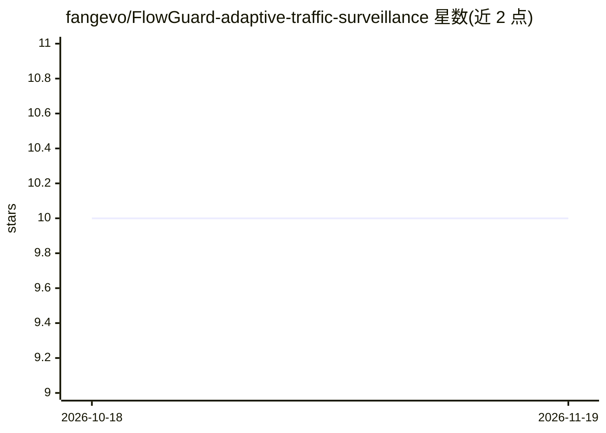

# fangevo/FlowGuard-adaptive-traffic-surveillance

⭐ 10 · Python · MIT · 推送 2026-02-11 · [GitHub](https://github.com/fangevo/FlowGuard-adaptive-traffic-surveillance) · 个人维护

**基于 YOLOv5 的实时车辆流量监测与计数系统**

用 YOLOv5 做实时车辆类型检测与双向车流计数，配合 ResNet50 天气识别（晴/雨/雪）自动调整各方向最大车流阈值并告警；提供 GUI 手动设置阈值与可视化，另含默认关闭的压实线变道检测功能。数据基于 UA-DETRAC 标注转换，需下载预训练权重运行；天气模型直接复用开源模型，在无显著天气特征的视频帧上预测可能不准确。

## 筛选速览

| 维度 | 判定 | 备注 |
|---|---|---|
| AI 角色 | `ai-native` | 本体是模型或模型工具 |
| 许可风险 | `permissive` | MIT |
| 部署形态 | `library` | 以包/库形式分发 |
| 模型依赖 | — | README 未给出锁定关系 |
| 硬件要求 | — | 无带数字的原话,不猜 |
| 安装摩擦 | `low` | 无编译、无系统依赖或容器化 |
| 成熟度 | — | 结构信号不足 |

## 能力要点

- YOLOv5 实时检测车辆类型并统计双向车流量
- ResNet50 天气识别驱动阈值动态调整（晴>雨>雪）
- GUI 可视化并支持手动设置各方向车流阈值
- 附训练脚本，可基于自有数据重新训练 YOLOv5

## 适用场景

- 对固定机位视频做双向车流实时统计
- 按天气条件自动调整车流告警阈值
- 高速公路场景的压实线变道检测（需手动配置 ROI）

## 场景标签

`目标检测` · 领域:感知与多模态

## 证据(README 行号)

> L2: This repository contains the code for a vehicle flow automatic detection system using YOLOv5, incorporating a weathe
> L4: The project implements basic functionalities including real-time detection of different vehicle types and real-time 
> L50:  * Execute `python train.py`

## 星数曲线

2026-10-18 10 → 2026-11-19 10（+0）

---
*卡片 v1 · prompt 1.4 · 生成 2026-11-19 · 置信度 high · 依据 README sha `92ebd2a61740` · [字段定义](../../DATASET.md)*
