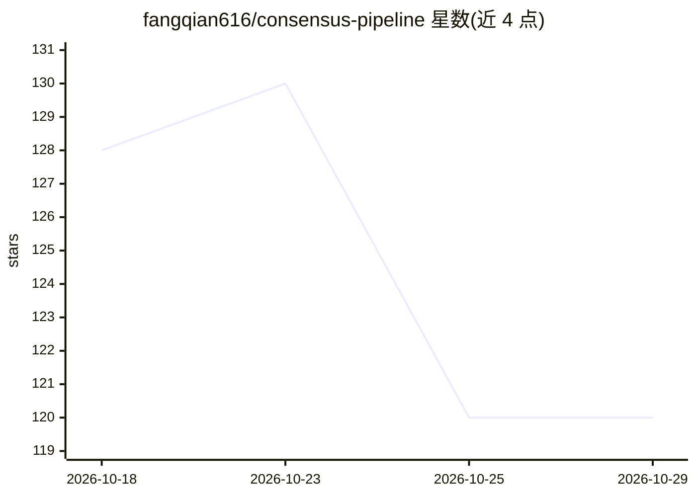

# fangqian616/consensus-pipeline

⭐ 120 · Python · MIT · 推送 2026-10-10 · [GitHub](https://github.com/fangqian616/consensus-pipeline) · [官网](https://consensus-pipeline.streamlit.app/) · 个人维护 · 中文 README

**多智能体辩论式文献综述生成管线，附引用核验与置信标注**

面向学术研究者的文献综述生成系统：以研究主题为输入，先由 AI 访谈需求并自动生成 10-11 个辩论部门（每个部门 2-4 名辩手），经多轮辩论（动态终止：立场量化 CV + Kendall's W）、跨部门交叉验证后产出带逐条置信标注的综述报告。覆盖 OpenAlex/Semantic Scholar/arXiv 多源检索、3 层质控过滤、NLI 引用核验（区分错误引用 vs 夸大表述）、全文补充与 PDF/DOCX 导出，支持中英双语。提供一键安装脚本、DSH 插件与 Streamlit/CLI 三种运行方式；无需 GPU，完整运行耗时随主题与论文量变化。

## 筛选速览

| 维度 | 判定 | 备注 |
|---|---|---|
| AI 角色 | `ai-native` | 本体是模型或模型工具 |
| 许可风险 | `permissive` | MIT |
| 部署形态 | `library` | 以包/库形式分发 |
| 模型依赖 | — | README 未给出锁定关系 |
| 硬件要求 | — | 无带数字的原话,不猜 |
| 安装摩擦 | `low` | 无编译、无系统依赖或容器化 |
| 成熟度 | `idea` | |

## 能力要点

- 11 个研究部门多轮辩论 + 动态终止（CV + Kendall's W）
- 逐条结论置信标注（如 42/77 papers, high confidence）
- NLI 引用核验：区分已验证/部分验证/矛盾/错误引用/夸大表述，不可判定声明单独列出不计分
- 全文补充：自动抓取 OA 全文或上传付费墙 PDF 强制纳入

## 适用场景

- 生成带逐条置信标注的学术文献综述
- 核查综述结论的引用依据与夸大表述
- 对候选论文池做多层质控与去重检索

## 场景标签

`多智能体` `科研工具` · 领域:Agent 开发

## 证据(README 行号)

> L9: > **Multi-agent debate framework for academic research.**
> L106: Consensus Pipeline takes a research topic and produces a structured literature review through multi-agent debate.
> L110: **Key difference from tools like Elicit/Consensus:** Those tools extract and summarize. This tool *debates*. Each 

## 星数曲线

2026-10-18 128 → 2026-10-29 120（-8）

---
*卡片 v1 · prompt 1.4 · 生成 2026-10-23 · 置信度 mid · 依据 README sha `204d0782f440` · [字段定义](../../DATASET.md)*
