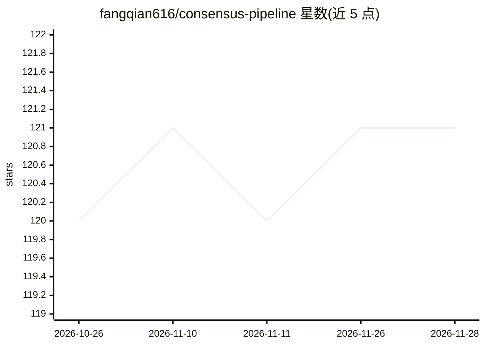

# fangqian616/consensus-pipeline

⭐ 121 · Python · MIT · 推送 2026-11-08 · [GitHub](https://github.com/fangqian616/consensus-pipeline) · [官网](https://consensus-pipeline.streamlit.app/) · 个人维护 · 中文 README

**学术文献综述的多智能体辩论管线，逐条核验引用**

面向学术研究场景的多智能体辩论框架：AI 先访谈用户明确研究范围，再按主题动态生成 11 个辩论部门（每部门 2–4 名辩手），经 3–8 轮辩论并以 CV 与 Kendall's W 动态判定收敛；论文检索接 OpenAlex/Semantic Scholar/arXiv 并经三层质检，最终输出带逐条置信度标注的双语报告（Markdown/DOCX/PDF）、可运行 Python 代码，并用两阶段 NLI 对每条引用对照摘要与全文核验。需配置 DEEPSEEK_API_KEY；提供 Streamlit 网页界面、CLI、DSH 插件与一键安装脚本。

## 筛选速览

| 维度 | 判定 | 备注 |
|---|---|---|
| AI 角色 | `ai-native` | 本体是模型或模型工具 |
| 许可风险 | `permissive` | MIT |
| 部署形态 | `library` | 以包/库形式分发 |
| 模型依赖 | locked-api |  |
| 硬件要求 | `cpu-ok` | |
| 安装摩擦 | `low` | 无编译、无系统依赖或容器化 |
| 成熟度 | — | 结构信号不足 |

## 能力要点

- 11 部门对抗性辩论，CV + Kendall's W 动态收敛终止
- 两阶段 NLI 引用核验：区分引文错配与表述夸大
- 逐条置信度标注（如 42/77 papers, high confidence）
- 自动抓取 OA 全文，Phase 5.5 断点补充付费墙 PDF

## 适用场景

- 生成长篇学术文献综述并核验每条引用
- 对研究结论输出逐条置信度与反方观点
- 自动生成实证/建模方法的可运行 Python 代码

## 场景标签

`多智能体` `科研工具` · 领域:Agent 开发

## 证据(README 行号)

> L18: > **Multi-agent debate framework for academic research.**
> L19: > Instead of one AI writing a literature review for you — an AI team interviews you, debates each claim across meth
> L114: - 🔍 **Multi-Source Paper Search & 3-Layer QC** — Queries OpenAlex + Semantic Scholar + arXiv with automatic dedupl

## 星数曲线

2026-10-26 120 → 2026-11-28 121（+1）

---
*卡片 v1 · prompt 1.4 · 生成 2026-11-28 · 置信度 high · 依据 README sha `8f0b0e83073f` · [字段定义](../../DATASET.md)*
