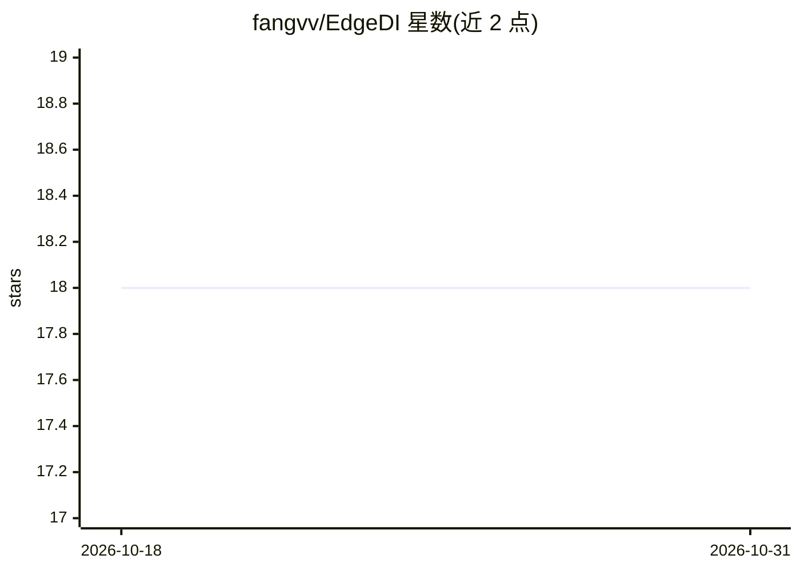

# fangvv/EdgeDI

⭐ 18 · Python · 推送 2026-10-08 · [GitHub](https://github.com/fangvv/EdgeDI) · [官网](https://fangvv.github.io/EdgeDI/) · 组织维护 · 中文 README

**IIoT 设备集群上分区分布式 DNN 推理框架（论文代码）**

ACM ToIT 论文 Joint Architecture Design and Workload Partitioning for DNN Inference on Industrial IoT Clusters 的源码。基于 PyTorch 实现，包含四个 DNN 骨干（VGG-13/16、ResNet-18/50）、L1 范数通道剪枝脚本、SE 类特征增强模块变体、贪心一维工作负载划分器（按设备算力与带宽预测延迟并平衡分配）。在 NEU-CLS 表面缺陷数据集与异构树莓派（Pi 3B+/Pi 4B）集群上评估。需 Python 3.7+ 与 PyTorch 1.x，面向科研复现。

## 筛选速览

| 维度 | 判定 | 备注 |
|---|---|---|
| AI 角色 | `ai-ecosystem` | LLM/agent 周边工具 |
| 许可风险 | `none` | — |
| 部署形态 | `library` | 以包/库形式分发 |
| 模型依赖 | — | README 未给出锁定关系 |
| 硬件要求 | — | 无带数字的原话,不猜 |
| 安装摩擦 | `low` | 无编译、无系统依赖或容器化 |
| 成熟度 | — | 结构信号不足 |

## 能力要点

- L1 范数驱动的逐层迭代通道剪枝，带精度下限停止条件
- 贪心一维特征图划分器，按设备算力/带宽延迟模型平衡负载
- 块边界插入 SE 类特征增强模块，剪枝后恢复精度
- 提供训练/测试/延迟与内存剖析脚本

## 适用场景

- 复现论文中 IIoT 集群分布式 DNN 推理实验
- 在树莓派等资源受限设备上部署剪枝后的视觉模型
- 研究异构边缘设备的工作负载划分方法

## 场景标签

`推理引擎` · 领域:训练与推理

## 证据(README 行号)

> L5: This is the source code for our paper: **Joint Architecture Design and Workload Partitioning for DNN Inference on In
> L7: The advent of Deep Neural Networks (DNNs) has empowered numerous computer-vision applications. Due to the high compu
> L9: 深度神经网络（DNN）的出现推动了众多计算机视觉应用的发展。由于DNN模型的高计算强度以及工业物联网（IIoT）设备资源受限的特性，在工业场景中高效部署和执行DNN通常面临巨大挑战。现有研究主要聚焦模型压缩或边缘-云端卸载方案，前者

## 星数曲线

2026-10-18 18 → 2026-10-31 18（+0）

---
*卡片 v1 · prompt 1.4 · 生成 2026-10-29 · 置信度 high · 依据 README sha `df3e4f9f5313` · [字段定义](../../DATASET.md)*
