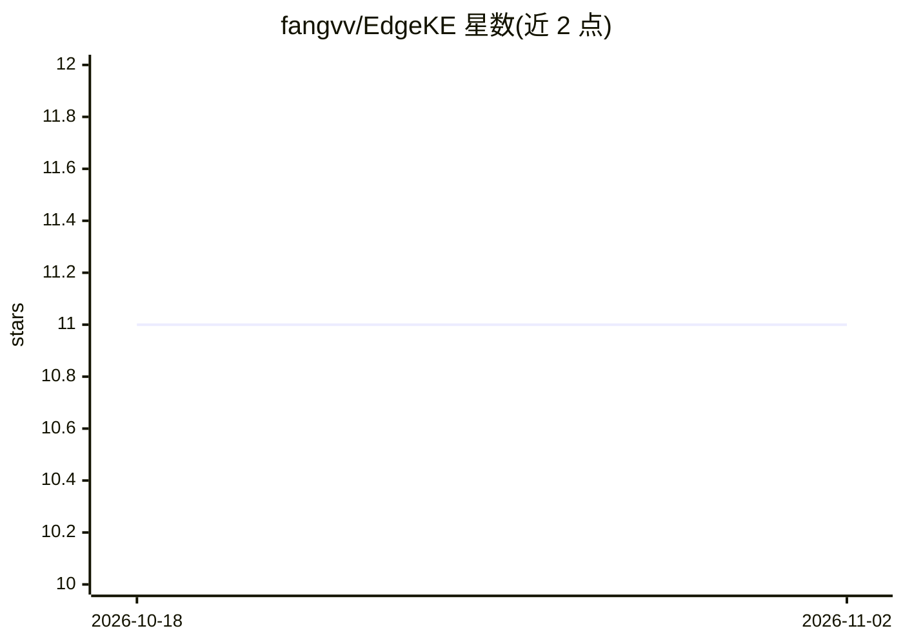

# fangvv/EdgeKE

⭐ 11 · Python · 推送 2026-10-08 · [GitHub](https://github.com/fangvv/EdgeKE) · [官网](https://fangvv.github.io/EdgeKE/) · 组织维护 · 中文 README

**工业边缘设备上按需 DNN 推理系统：知识蒸馏+提前退出**

IEEE TII 论文 EdgeKE 的源代码：面向资源受限的工业边缘设备，用两个机制组合压缩和加速 DNN——基于知识蒸馏训练紧凑学生模型（支持 KL/JS/Wasserstein 蒸馏损失），基于 BranchyNet 提前退出机制提供延迟/精度权衡的灵活推理。以 PyTorch 实现，在 CIFAR-100 与 ResNet 系列骨干上提供训练与评测入口脚本，推理管道按分段切分以测量各级延迟；实验报告延迟约束下精度损失不超过 4.84%、加速比最高 3.30 倍。面向科研复现与边缘推理方法研究。

## 筛选速览

| 维度 | 判定 | 备注 |
|---|---|---|
| AI 角色 | `ai-native` | 本体是模型或模型工具 |
| 许可风险 | `none` | — |
| 部署形态 | `library` | 以包/库形式分发 |
| 模型依赖 | — | README 未给出锁定关系 |
| 硬件要求 | — | 无带数字的原话,不猜 |
| 安装摩擦 | `medium` | 含编译或系统依赖之一 |
| 成熟度 | — | 结构信号不足 |

## 能力要点

- 知识蒸馏训练（KL/JS/Wasserstein 三种距离损失）
- BranchyNet 提前退出：阈值退出与加权投票推理
- 三种深度的分支分类器对应三个早退点（ResNet 变体）
- 分段式推理模型支持逐段延迟测量

## 适用场景

- 复现论文中边缘设备上的推理延迟/精度实验
- 在 CIFAR-100 上训练带早退分支的 ResNet 模型
- 研究知识蒸馏与提前退出组合的训练策略

## 场景标签

`科研工具` `推理引擎` · 领域:学习与行业

## 证据(README 行号)

> L5: This is the source code for our paper: **EdgeKE: An On-Demand Deep Learning IoT System for Cognitive Big Data on Ind
> L7: > Motivated by the prospects of 5G communications and industrial Internet of Things (IoT), recent years have seen th
> L53: Implements the **early-exit (BranchyNet)** mechanism, the second core design knob of EdgeKE. Includes training stra

## 星数曲线

2026-10-18 11 → 2026-11-02 11（+0）

---
*卡片 v1 · prompt 1.4 · 生成 2026-11-02 · 置信度 high · 依据 README sha `cd0ba273e706` · [字段定义](../../DATASET.md)*
