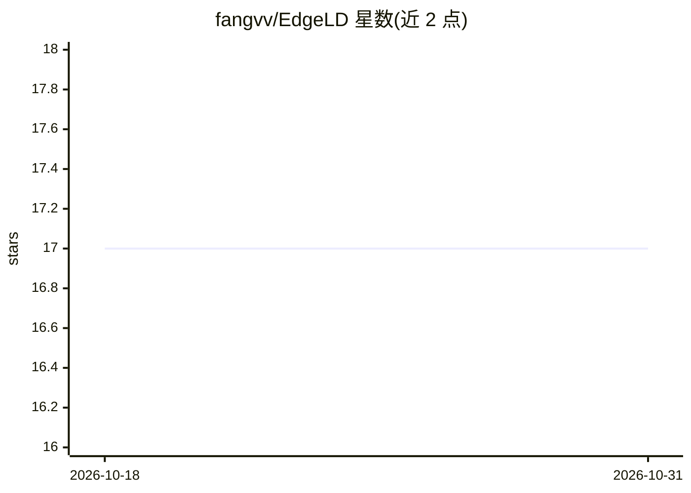

# fangvv/EdgeLD

⭐ 17 · Python · 推送 2026-10-08 · [GitHub](https://github.com/fangvv/EdgeLD) · [官网](https://fangvv.github.io/EdgeLD/) · 组织维护 · 中文 README

**论文代码：在边缘设备集群上分布式执行 DNN 推理的框架**

IEEE HPCC 2020 论文 EdgeLD 的源码实现，面向希望在多台边缘设备上本地分布式运行 DNN 推理的研究者。机制：先对模型按各设备计算能力（线性回归 t=a*FLOPs+b）与网络带宽做时间成本画像，再以 maxpool 层为边界做特征图划分，均衡各设备负载；配合层融合与差分交换（只回传边界切片）降低通信开销。基于 PyTorch 与 TCP socket 实现 NameNode/DataNode 主从架构，包含 VGG13 分层模型与四种执行场景。需在局域网内多台设备上手工配置部署，属于研究原型而非产品。

## 筛选速览

| 维度 | 判定 | 备注 |
|---|---|---|
| AI 角色 | `ai-ecosystem` | LLM/agent 周边工具 |
| 许可风险 | `none` | — |
| 部署形态 | `library` | 以包/库形式分发 |
| 模型依赖 | — | README 未给出锁定关系 |
| 硬件要求 | — | 无带数字的原话,不猜 |
| 安装摩擦 | `low` | 无编译、无系统依赖或容器化 |
| 成熟度 | — | 结构信号不足 |

## 能力要点

- 按计算能力与网络带宽双维度画像引导的模型划分方案
- 层融合与差分交换降低设备间通信开销
- NameNode/DataNode 主从架构，TCP socket 传输序列化张量
- VGG13 按层拆分为模块，支持 forward(x, start, end) 部分推理

## 适用场景

- 在 2-4 台边缘设备集群上加速 DNN 推理实验复现
- 研究模型划分与分布式推理的负载均衡策略
- 边缘计算课程的分布式推理教学示例

## 场景标签

`推理引擎` · 领域:训练与推理

## 证据(README 行号)

> L5: This is the source code for our paper: **EdgeLD: Locally Distributed Deep Learning Inference on Edge Device Clusters
> L7: > Deep Neural Networks (DNN) have been widely used in a large number of application scenarios. However, DNN models a

## 星数曲线

2026-10-18 17 → 2026-10-31 17（+0）

---
*卡片 v1 · prompt 1.4 · 生成 2026-10-29 · 置信度 mid · 依据 README sha `9f0f4bb34746` · [字段定义](../../DATASET.md)*
