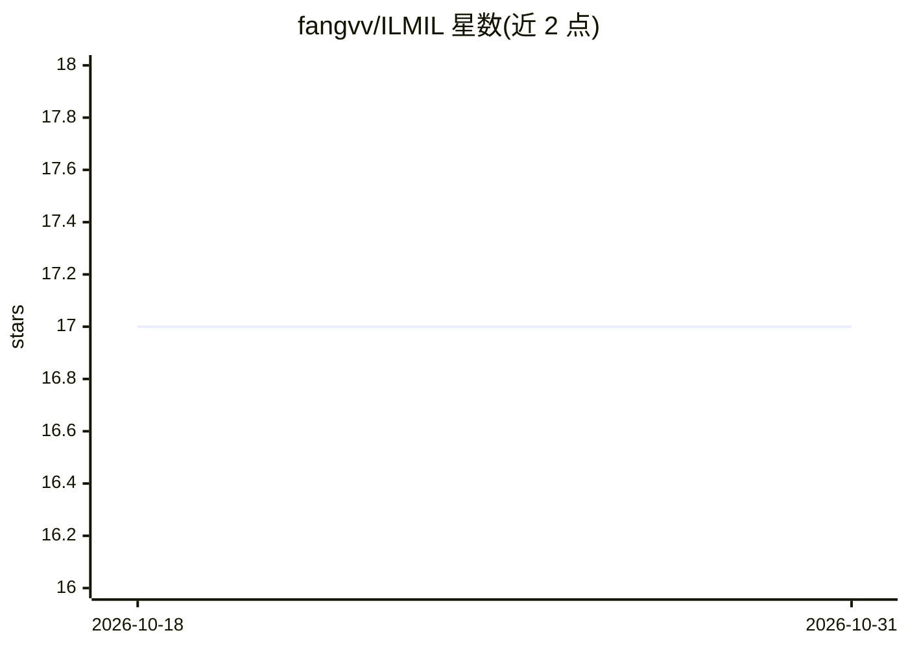

# fangvv/ILMIL

⭐ 17 · Python · 推送 2026-10-08 · [GitHub](https://github.com/fangvv/ILMIL) · [官网](https://fangvv.github.io/ILMIL/) · 组织维护 · 中文 README

**基于多中间层知识蒸馏的目标检测增量学习论文代码**

论文《基于知识蒸馏的目标检测模型增量深度学习方法》(ILMIL) 的源码，面向科研复现者。基于 Faster R-CNN (VGG16) 实现增量学习：通过 MFRRK 蒸馏损失（RPN/RCN 中间层特征 hint_loss 与分类 scores_loss）由教师模型指导学生模型在新类数据上增量训练，缓解灾难性遗忘；另含全阶段特征蒸馏扩展、L1 范数通道剪枝、剪枝+蒸馏组合、Soft-NMS 集成推理与难例挖掘。数据采用 PASCAL VOC 2007 格式，训练需 CUDA GPU，配置路径硬编码为 Linux 路径需手动修改。

## 筛选速览

| 维度 | 判定 | 备注 |
|---|---|---|
| AI 角色 | `ai-native` | 本体是模型或模型工具 |
| 许可风险 | `none` | — |
| 部署形态 | `library` | 以包/库形式分发 |
| 模型依赖 | — | README 未给出锁定关系 |
| 硬件要求 | — | 无带数字的原话,不猜 |
| 安装摩擦 | `medium` | 含编译或系统依赖之一 |
| 成熟度 | — | 结构信号不足 |

## 能力要点

- MFRRK 多中间层（RPN/RCN 特征）知识蒸馏缓解灾难性遗忘
- L1 范数通道剪枝与蒸馏组合实现模型压缩
- 全阶段 VGG16 特征蒸馏扩展与 Soft-NMS 集成推理
- 提供含灾难性遗忘基线的完整实验目录结构

## 适用场景

- 复现论文中的增量目标检测实验
- 在新类数据上增量训练检测器并保留旧类知识
- 研究剪枝与知识蒸馏结合的边缘部署压缩方案

## 场景标签

`目标检测` `科研工具` · 领域:学习与行业

## 证据(README 行号)

> L5: This is the source code for our paper: **基于知识蒸馏的目标检测模型增量深度学习方法 (Incremental Learning Method based on Knowledge Disti
> L9: > With the advent of the Internet of Everything era, the number of IoT devices with object detection capabilities ha

## 星数曲线

2026-10-18 17 → 2026-10-31 17（+0）

---
*卡片 v1 · prompt 1.4 · 生成 2026-10-29 · 置信度 high · 依据 README sha `1d84c4d83f27` · [字段定义](../../DATASET.md)*
