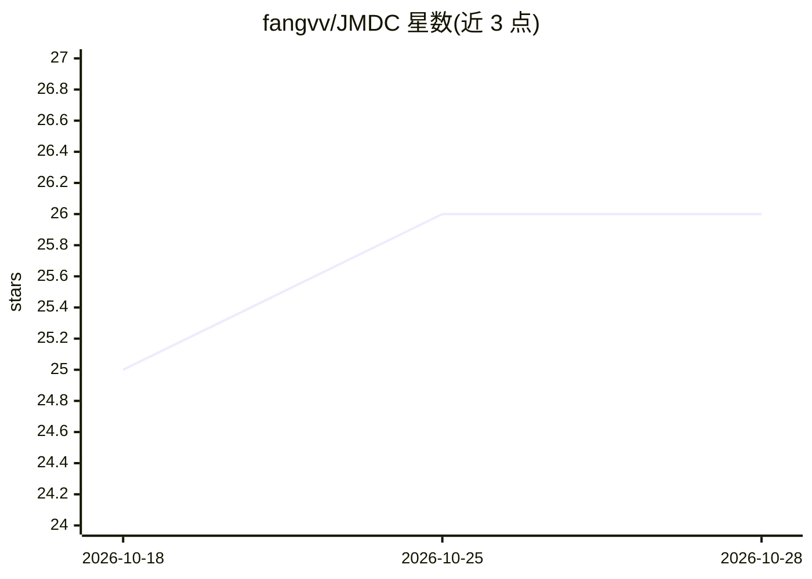

# fangvv/JMDC

⭐ 26 · Python · 推送 2026-10-08 · [GitHub](https://github.com/fangvv/JMDC) · [官网](https://fangvv.github.io/JMDC/) · 组织维护 · 中文 README

**论文代码：边云协同 DNN 推理的模型与数据联合压缩框架**

JPDC 2023 论文 "JMDC" 的源码：在中间层将 DNN 分割为边缘与云端两部分顺序执行，采用注意力机制选择重要模型通道与中间输出重要区域，并以可配置位宽量化压缩传输数据；可根据延迟/精度需求与资源条件自适应确定分割点与压缩策略。实现基于 PyTorch，支持 AlexNet/VGG16 逐层执行，云端服务器与边缘客户端通过 TCP socket 通信，在 Raspberry Pi 4B 与 CIFAR-10 上做了实验。运行需自行准备 CIFAR-10 数据集与预训练模型 .pkl 文件。

## 筛选速览

| 维度 | 判定 | 备注 |
|---|---|---|
| AI 角色 | `ai-ecosystem` | LLM/agent 周边工具 |
| 许可风险 | `none` | — |
| 部署形态 | `None` |  |
| 模型依赖 | — | README 未给出锁定关系 |
| 硬件要求 | — | 无带数字的原话,不猜 |
| 安装摩擦 | `low` | 无编译、无系统依赖或容器化 |
| 成熟度 | — | 结构信号不足 |

## 能力要点

- 注意力机制选择重要通道与中间输出区域
- 可配置位宽的张量量化模块压缩传输数据
- 逐层执行接口支持 AlexNet/VGG16 的边云分割
- 自适应确定最佳分割点与压缩策略

## 适用场景

- 复现边云协同 DNN 推理的论文实验
- 研究 DNN 分割与量化对延迟/精度的影响
- 在 Raspberry Pi 等边缘设备上实验低延迟推理

## 场景标签

`模型量化` `推理引擎` · 领域:训练与推理

## 证据(README 行号)

> L5: This is the source code for our paper: **JMDC: A Joint Model and Data Compression System for Deep Neural Networks Co
> L6: > Deep Neural Networks (DNNs) have shown exceptional promise in providing Artificial Intelligence (AI) to many compu
> L39: ### Edge Client (`initMobile.py`)

## 星数曲线

2026-10-18 25 → 2026-10-28 26（+1）

---
*卡片 v1 · prompt 1.4 · 生成 2026-10-26 · 置信度 high · 依据 README sha `6886eecf7b0c` · [字段定义](../../DATASET.md)*
