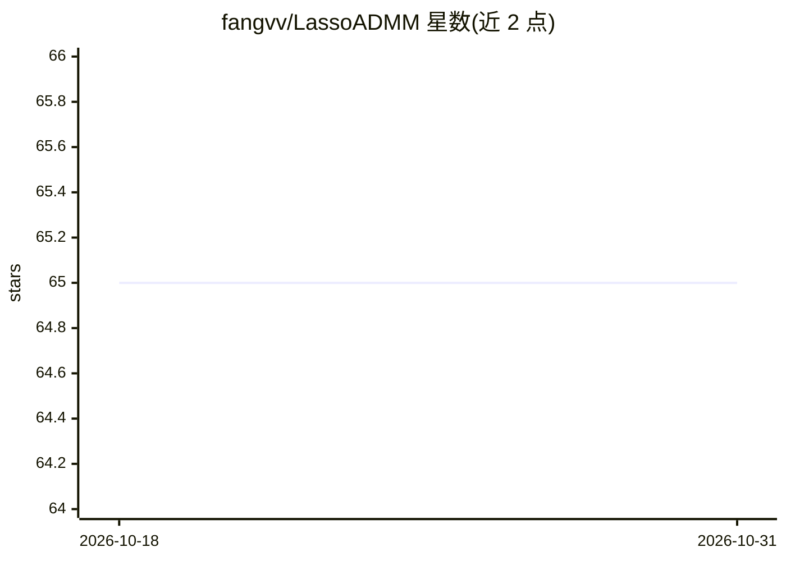

# fangvv/LassoADMM

⭐ 65 · MATLAB · GPL-3.0 · 推送 2026-10-08 · [GitHub](https://github.com/fangvv/LassoADMM) · [官网](https://fangvv.github.io/LassoADMM/) · 组织维护

**论文代码：边缘计算下分布式 ADMM 求解 lasso 回归**

论文《A Distributed ADMM Approach for Collaborative Regression Learning in Edge Computing》（CMC 2019，ICAIS 2019 最佳论文奖）的 MATLAB 源代码。针对 IoT 设备数据保留在源端、不宜上传云端的场景，将 lasso 回归问题用 ADMM 分解为子问题，各 IoT 设备用本地数据求解，迭代过程中仅向边缘服务器提交中间结果，实现在数据不出本地的情况下完成回归训练。实验基于两个公开数据集。运行需自备 MATLAB。

## 筛选速览

| 维度 | 判定 | 备注 |
|---|---|---|
| AI 角色 | `ai-native` | 本体是模型或模型工具 |
| 许可风险 | `viral` | GPL-3.0 |
| 部署形态 | `None` |  |
| 模型依赖 | — | README 未给出锁定关系 |
| 硬件要求 | — | 无带数字的原话,不猜 |
| 安装摩擦 | `low` | 无编译、无系统依赖或容器化 |
| 成熟度 | — | 结构信号不足 |

## 能力要点

- ADMM 将 lasso 回归分解为各 IoT 设备本地可解的子问题
- 设备仅向边缘服务器提供中间结果，训练数据保留在本地
- MATLAB 实现，配套论文获 ICAIS 2019 最佳论文奖

## 适用场景

- 复现论文中的边缘 lasso 回归实验
- 研究联邦/边缘场景下的分布式优化算法
- 基于公开数据集对比分布式回归方法

## 场景标签

 · 领域:机器学习/边缘计算

## 证据(README 行号)

> L5: This is the source code for our paper: **A Distributed ADMM Approach for Collaborative Regression Learning in Edge C
> L7: > With the recent proliferation of Internet-of-Things (IoT), enormous amount of data are produced by wireless sensor
> L15: Matlab

## 星数曲线

2026-10-18 65 → 2026-10-31 65（+0）

---
*卡片 v1 · prompt 1.4 · 生成 2026-10-24 · 置信度 high · 依据 README sha `89133b12e6b4` · [字段定义](../../DATASET.md)*
