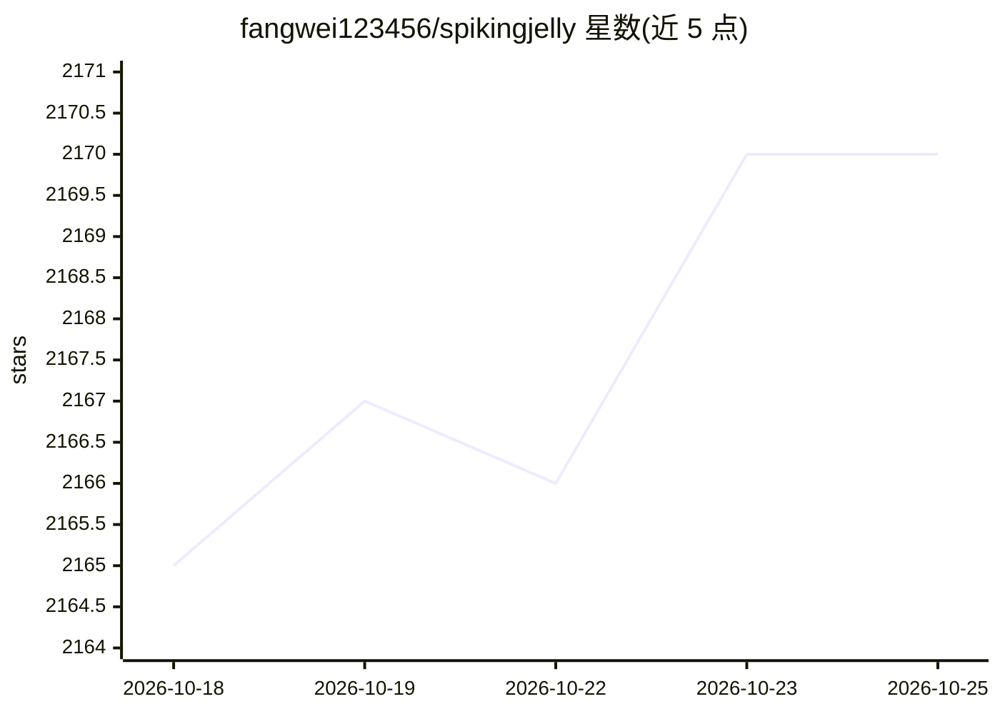

# fangwei123456/spikingjelly

⭐ 2,173 · Python · Apache-2.0 · 推送 2026-10-25 · [GitHub](https://github.com/fangwei123456/spikingjelly) · [官网](https://spikingjelly.readthedocs.io) · 组织维护 · 中文 README

**基于 PyTorch 的脉冲神经网络（SNN）深度学习框架**

SpikingJelly 是 PyTorch 原生的脉冲神经网络框架，提供脉冲神经元与替代梯度组件、预定义 SNN 模型、ANN2SNN 转换、在线学习工具与混合精度训练。算子执行在 Torch/Triton/可选原生 CUDA 之间自动选择，支持内存高效训练（memopt 脉冲压缩）、实验性多 GPU 分布式执行，内置 13 个神经形态事件数据集（如 CIFAR10-DVS、N-MNIST、SHD），并可经 NIR/Lava/Lynxi 导出至神经形态硬件。面向 SNN 研究与开发者，由北京大学与鹏城实验室团队维护，V2 采用 SemVer 版本策略。

## 筛选速览

| 维度 | 判定 | 备注 |
|---|---|---|
| AI 角色 | `ai-native` | 本体是模型或模型工具 |
| 许可风险 | `permissive` | Apache-2.0 |
| 部署形态 | `library` | 以包/库形式分发 |
| 模型依赖 | — | README 未给出锁定关系 |
| 硬件要求 | — | 无带数字的原话,不猜 |
| 安装摩擦 | `medium` | 含编译或系统依赖之一 |
| 成熟度 | — | 结构信号不足 |

## 能力要点

- 脉冲神经元、替代梯度与预定义 SNN 模型组件
- ANN2SNN 转换与在线学习工具
- Torch/Triton/原生 CUDA 自动算子执行与 memopt 内存高效训练
- 内置 13 个神经形态事件数据集与 NIR/Lava/Lynxi 交换导出

## 适用场景

- 用 PyTorch 风格 API 搭建与训练脉冲神经网络
- 将训练好的 ANN 转换为 SNN 部署
- 在神经形态事件数据集上做训练与评测
- 导出模型到神经形态硬件或其他框架

## 场景标签

`模型训练` · 领域:训练与推理

## 证据(README 行号)

> L18: SpikingJelly is a PyTorch-native framework for spiking neural networks (SNNs), with support for large-scale SNN tra
> L72: |SNN modeling|Activation-based SNN components: spiking neurons, surrogate gradients, stateful and stateless modules

## 星数曲线

2026-10-18 2,165 → 2026-10-25 2,170（+5）

---
*卡片 v1 · prompt 1.4 · 生成 2026-10-21 · 置信度 high · 依据 README sha `82dfe8aa9059` · [字段定义](../../DATASET.md)*
