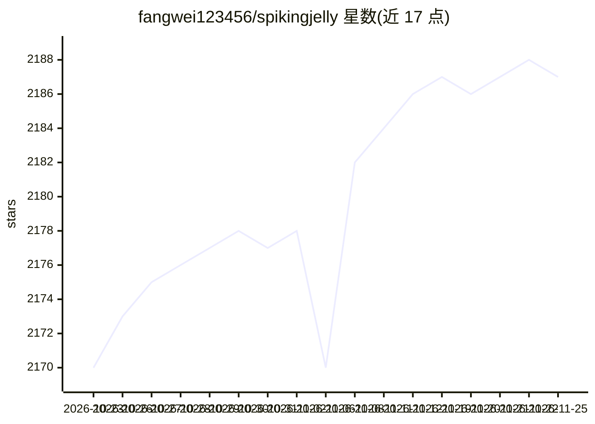

# fangwei123456/spikingjelly

⭐ 2,187 · Python · Apache-2.0 · 推送 2026-11-23 · [GitHub](https://github.com/fangwei123456/spikingjelly) · [官网](https://spikingjelly.readthedocs.io) · 组织维护 · 中文 README

**基于 PyTorch 的脉冲神经网络开源深度学习框架**

SpikingJelly 是一个 PyTorch 原生的 SNN 框架，支持大规模脉冲神经网络训练与推理。提供脉冲神经元、代理梯度等组件与预定义模型，支持 ANN2SNN 转换、14 个神经形态/事件数据集、FLOPs/SynOps 剖析与能耗估计，以及 NIR、Lava、灵汐硬件的交换/部署接口。算子执行按设备自动选择 Torch/Triton/原生 CUDA；支持内存高效训练、分布式与混合精度。安装要求 Python>=3.11、Torch>=2.6，许可证 Apache-2.0，由北京大学与鹏城实验室等机构维护。

## 筛选速览

| 维度 | 判定 | 备注 |
|---|---|---|
| AI 角色 | `ai-native` | 本体是模型或模型工具 |
| 许可风险 | `permissive` | Apache-2.0 |
| 部署形态 | `library` | 以包/库形式分发 |
| 模型依赖 | — | README 未给出锁定关系 |
| 硬件要求 | — | 无带数字的原话,不猜 |
| 安装摩擦 | `medium` | 含编译或系统依赖之一 |
| 成熟度 | — | 结构信号不足 |

## 能力要点

- PyTorch 原生 API 与 ANN2SNN 转换
- 14 个事件驱动/神经形态数据集及预处理流水线
- 自动选择 Torch/Triton/原生 CUDA 算子执行，支持 fp8 等低精度
- 导出至 NIR、Lava 与灵汐神经形态硬件

## 适用场景

- 构建和训练脉冲神经网络模型
- 在神经形态数据集上做事件视觉/语音任务训练
- 将 ANN 转换为 SNN 并部署到神经形态硬件
- 分析 SNN 推理的脉冲数与能耗

## 场景标签

`模型训练` `推理引擎` · 领域:训练与推理

## 证据(README 行号)

> L18: SpikingJelly is a PyTorch-native framework for spiking neural networks (SNNs), with support for large-scale SNN tra
> L72: |SNN modeling|Activation-based SNN components: spiking neurons, surrogate gradients, stateful and stateless modules
> L105: SpikingJelly includes the following event-based and neuromorphic datasets:

## 星数曲线

2026-10-23 2,170 → 2026-11-25 2,187（+17）

---
*卡片 v1 · prompt 1.4 · 生成 2026-11-23 · 置信度 high · 依据 README sha `0e7eda5222bd` · [字段定义](../../DATASET.md)*
