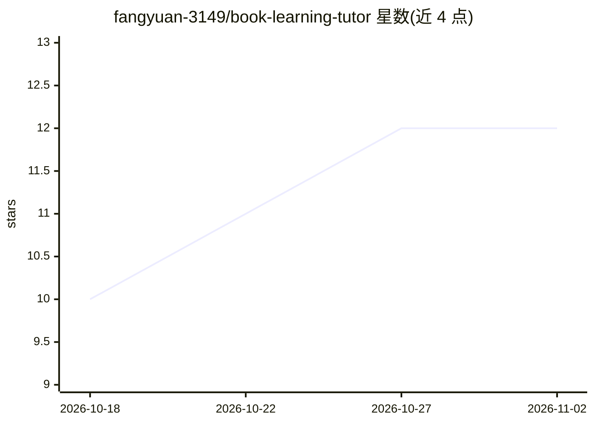

# fangyuan-3149/book-learning-tutor

⭐ 12 · Python · NOASSERTION · 推送 2026-10-26 · [GitHub](https://github.com/fangyuan-3149/book-learning-tutor) · [官网](https://github.com/fangyuan-3149/book-learning-tutor) · 个人维护 · 中文 README

**把本地电子书课程化并由 AI 逐课教学的 Agent 技能**

面向学习者的 Agent Skill（SKILL.md 形式）：将用户提供的本地书文件（PDF/EPUB/DJVU/MOBI/AZW/DOCX/TXT/MD/CBZ）解析为「目录导读+章+课」的课程文件夹，随后由宿主 agent 按备课→费曼讲解→练习闸门（≥80%）→作业/背诵→间隔复习的节奏逐课教学，进度存于 progress.json 可跨会话续学。本地优先：不做网络请求、无外部 LLM key，智能步骤全部由宿主 agent 完成，工具仅做解析与持久化。运行于 Claude Code / Copilot CLI / WorkBuddy / Amp / OpenClaw 等宿主；联网找书功能已拆分至独立 book-finder 技能。

## 筛选速览

| 维度 | 判定 | 备注 |
|---|---|---|
| AI 角色 | `ai-native` | 本体是模型或模型工具 |
| 许可风险 | `permissive` | NOASSERTION |
| 部署形态 | `None` |  |
| 模型依赖 | — | README 未给出锁定关系 |
| 硬件要求 | — | 无带数字的原话,不猜 |
| 安装摩擦 | `low` | 无编译、无系统依赖或容器化 |
| 成熟度 | — | 结构信号不足 |

## 能力要点

- 支持 8+ 种本地书格式解析并课程化为结构化课树
- 练习闸门（≥80%）+ 背诵作业 + 间隔复习的教学闭环
- 纯本地运行、零外部 LLM key、默认无网络调用
- 跨宿主运行（WorkBuddy/Claude Code/Copilot CLI/Amp/OpenClaw）

## 适用场景

- 把自己硬盘里的书变成一对一 AI 辅导课程
- 按间隔复习节奏记忆书中重点并脱稿背诵
- 跨会话续学，从上次进度继续上课

## 场景标签

`AI 助手` `文档解析` · 领域:对话与助手

## 证据(README 行号)

> L3: > Turn any book on your drive into a **personal AI tutor** that actually teaches — lesson by lesson, with Feynman ex
> L104: One skill contains the full teaching engine — material production (what to teach) + prep / Feynman / practice gate
> L137: - Python 3.13 (or 3.11+); **no Node, no browser, no network needed**

## 星数曲线

2026-10-18 10 → 2026-11-02 12（+2）

---
*卡片 v1 · prompt 1.4 · 生成 2026-11-01 · 置信度 high · 依据 README sha `47f8b4ae4580` · [字段定义](../../DATASET.md)*
