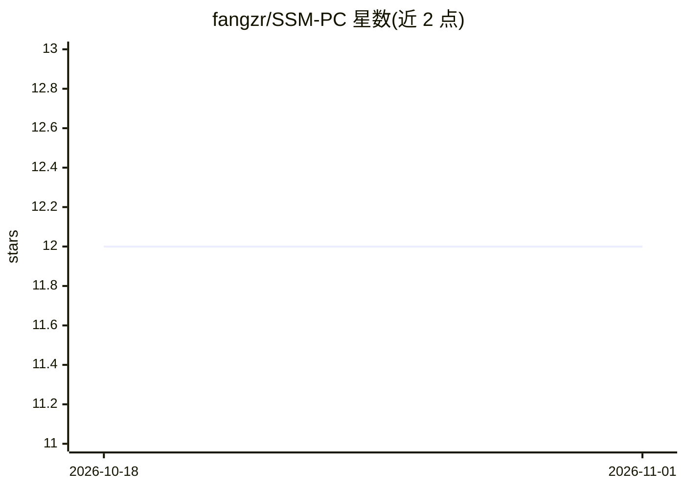

# fangzr/SSM-PC

⭐ 12 · Python · MIT · 推送 2025-11-07 · [GitHub](https://github.com/fangzr/SSM-PC) · [官网](http://fangzr.github.io/SSM-PC/index.html) · 组织维护

**论文官方代码：预测编码实现多智能体共享空间记忆**

论文《Shared Spatial Memory Through Predictive Coding》(Fang et al., 2025) 的官方开源实现。框架整合网格细胞式空间编码、预测式 BEV 重建与通信高效的共享空间记忆。目前已开源两个模块：grid_cell 空间度量学习（支持 DDP 多 GPU 训练、网格度分析与可视化）与 bev_generation 预测式 BEV 重建（Transformer 视觉预测模型）。共享空间记忆与 HRL-ICM 层级强化学习模块标注为 Planned/Pending 状态。提供 pip requirements 安装、数据集准备说明与论文结果复现步骤。面向计算神经科学与多智能体强化学习方向的研究者。

## 筛选速览

| 维度 | 判定 | 备注 |
|---|---|---|
| AI 角色 | `ai-native` | 本体是模型或模型工具 |
| 许可风险 | `permissive` | MIT |
| 部署形态 | `library` | 以包/库形式分发 |
| 模型依赖 | — | README 未给出锁定关系 |
| 硬件要求 | — | 无带数字的原话,不猜 |
| 安装摩擦 | `low` | 无编译、无系统依赖或容器化 |
| 成熟度 | — | 结构信号不足 |

## 能力要点

- 网格细胞空间度量学习模块：自监督运动预测中涌现网格编码，支持多 GPU 训练与网格度分析
- 预测式 BEV 重建模块：从第一视角 RGB 帧重建鸟瞰图
- 共享空间记忆与 HRL-ICM 模块为计划中（Pending）状态

## 适用场景

- 复现论文中 Memory-Maze 基准的实验结果
- 研究网格细胞编码与空间度量学习
- 基于 BEV 重建做空间记忆可视化

## 场景标签

`图像视频处理` · 领域:感知与多模态

## 证据(README 行号)

> L3: This repository provides the official open-source implementation of
> L5: The framework unifies grid-cell-like spatial coding, predictive BEV reconstruction,
> L18: - A **grid-cell-like metric scaffold** emerging from self-supervised motion forecasting, supporting accurate self-l

## 星数曲线

2026-10-18 12 → 2026-11-01 12（+0）

---
*卡片 v1 · prompt 1.4 · 生成 2026-11-01 · 置信度 mid · 依据 README sha `825604025087` · [字段定义](../../DATASET.md)*
