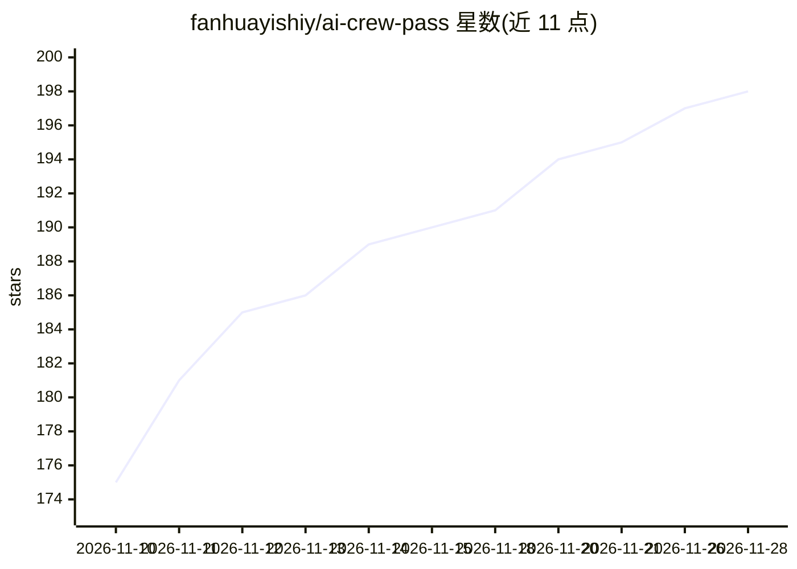

# fanhuayishiy/ai-crew-pass

⭐ 198 · TypeScript · MIT · 推送 2026-11-17 · [GitHub](https://github.com/fanhuayishiy/ai-crew-pass) · [官网](https://badge.fhysy.com/) · 个人维护 · 中文 README

**给 AI 角色和自定义形象生成可拖拽翻面的 3D 工牌**

基于 Astro、React 与 Three.js 的趣味工牌生成网页：内置九位 AI 角色与人物特别篇形象，支持原版/Q 版切换、3D 挂绳拖拽回摆与翻面、编辑模式替换文字与本地图片（≤20MB），图片在浏览器本地处理不上传服务器。可下载透明背景 PNG 或 ZIP，WebGL 不可用时回退到静态预览。通过 GitHub Pages 部署，本地运行需 Node.js 22.12+。角色均为非官方同人形象，素材按各自许可单独声明。

## 筛选速览

| 维度 | 判定 | 备注 |
|---|---|---|
| AI 角色 | `ai-enhanced` | 去掉 AI 部分产品仍成立 |
| 许可风险 | `permissive` | MIT |
| 部署形态 | `library` | 以包/库形式分发 |
| 模型依赖 | — | README 未给出锁定关系 |
| 硬件要求 | — | 无带数字的原话,不猜 |
| 安装摩擦 | `low` | 无编译、无系统依赖或容器化 |
| 成熟度 | — | 结构信号不足 |

## 能力要点

- 九位 AI 角色（DeepSeek、ChatGPT、GLM、Qwen、Gemini、Claude、Kimi、Grok、豆包）及 Q 版切换
- React Bits Lanyard 的 3D 挂绳、拖拽回摆与翻面交互
- 编辑模式支持上传本地图片裁剪替换，本地处理不上传服务器
- 透明背景 PNG/ZIP 下载，WebGL 不可用时提供静态预览回退

## 适用场景

- 给自己喜欢的 AI 角色生成一张趣味 3D 工牌
- 上传自定义图片和文字制作个性化工牌并下载透明 PNG
- fork 后修改角色与文案部署自己的工牌站点

## 场景标签

`图像生成` · 领域:内容生成

## 证据(README 行号)

> L11: 一个支持中文 / English 的趣味工牌小项目：选择 AI 角色或人物特别篇，也可以自定义形象和文字；拖动挂绳、点击翻面，再把工牌下载下来。由 **风花AI实验室** 分享。
> L27: - 九位 AI 同事：DeepSeek、ChatGPT、GLM、Qwen、Gemini、Claude、Kimi、Grok、豆包。
> L30: - React Bits 官方 Lanyard 的 3D 挂绳、拖拽回摆与翻面；同色系 ShinyText 背景扫光。

## 星数曲线

2026-11-10 175 → 2026-11-28 198（+23）

---
*卡片 v1 · prompt 1.4 · 生成 2026-11-25 · 置信度 high · 依据 README sha `5b7ed9c5fcac` · [字段定义](../../DATASET.md)*
