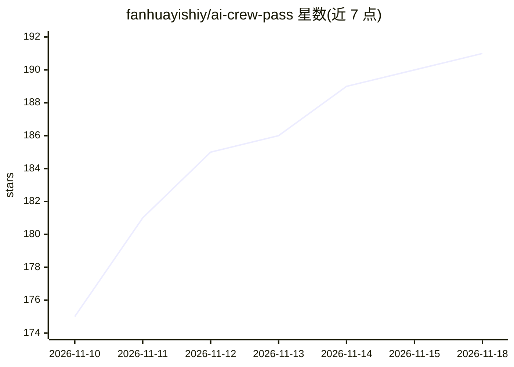

# fanhuayishiy/ai-crew-pass

⭐ 191 · TypeScript · MIT · 推送 2026-11-17 · [GitHub](https://github.com/fanhuayishiy/ai-crew-pass) · [官网](https://badge.fhysy.com/) · 个人维护 · 中文 README

**给 AI 角色发可拖拽 3D 工牌的趣味网页小项目**

基于 Astro、React 与 Three.js 的中英文双语工牌生成网页：内置九位 AI 角色（DeepSeek、ChatGPT、GLM、Qwen、Gemini、Claude、Kimi、Grok、豆包）及人物特别篇，3D 挂绳支持拖拽回摆与点击翻面，可切换原版/Q 版形象，自定义正反面文字与上传本地图片裁剪替换，下载透明背景 PNG 或 ZIP。自定义内容仅在浏览器本地处理，不上传服务器。本地运行需 Node.js 22.12+，源码分部分遵循不同许可，素材多为非商业同人展示。由风花AI实验室（微信公众号）分享。

## 筛选速览

| 维度 | 判定 | 备注 |
|---|---|---|
| AI 角色 | `ai-enhanced` | 去掉 AI 部分产品仍成立 |
| 许可风险 | `permissive` | MIT |
| 部署形态 | `library` | 以包/库形式分发 |
| 模型依赖 | — | README 未给出锁定关系 |
| 硬件要求 | — | 无带数字的原话,不猜 |
| 安装摩擦 | `low` | 无编译、无系统依赖或容器化 |
| 成熟度 | — | 结构信号不足 |

## 能力要点

- React Bits Lanyard 的 3D 挂绳拖拽回摆与翻面
- 九位 AI 角色原版/Q 版切换，支持编辑文字与上传图片裁剪替换
- 下载透明背景 PNG 或 ZIP，编辑内容本地处理不上传
- WebGL 不可用时提供静态预览，关闭脚本仍可下载

## 适用场景

- 给喜欢的 AI 角色生成并下载一张 3D 工牌图片
- 自定义头像和文字制作个人化工牌
- 修改角色素材后自行部署到 GitHub Pages

## 场景标签

 · 领域:创意/趣味网页工具

## 证据(README 行号)

> L11: 一个支持中文 / English 的趣味工牌小项目：选择 AI 角色或人物特别篇，也可以自定义形象和文字；拖动挂绳、点击翻面，再把工牌下载下来。由 **风花AI实验室** 分享。
> L27: - 九位 AI 同事：DeepSeek、ChatGPT、GLM、Qwen、Gemini、Claude、Kimi、Grok、豆包。

## 星数曲线

2026-11-10 175 → 2026-11-18 191（+16）

---
*卡片 v1 · prompt 1.4 · 生成 2026-11-17 · 置信度 mid · 依据 README sha `cd5a199e0606` · [字段定义](../../DATASET.md)*
