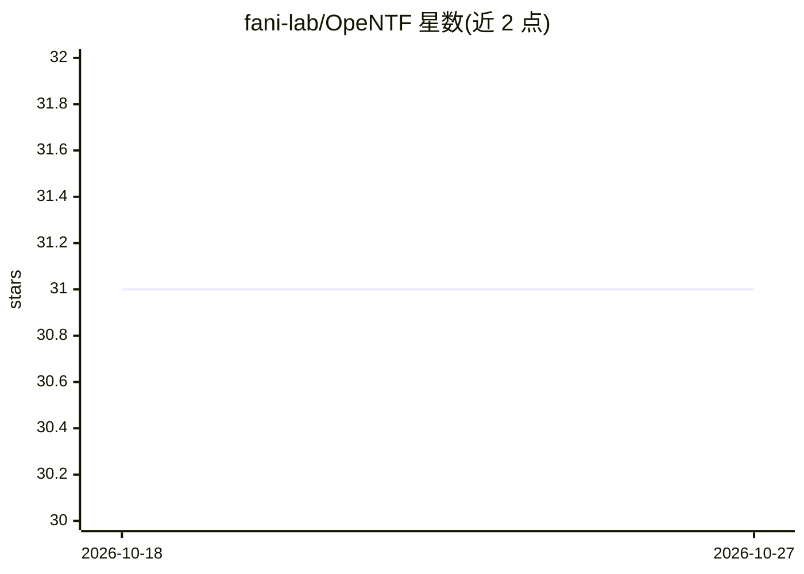

# fani-lab/OpeNTF

⭐ 31 · Python · NOASSERTION · 推送 2026-09-29 · [GitHub](https://github.com/fani-lab/OpeNTF) · 组织维护

**神经团队组建/推荐的开源基准库：训练模型预测专家团队**

面向研究者的神经团队组建（team formation/recommendation）框架：给定技能需求，通过多标签分类、Seq2Seq/Transformer（OpenNMT 封装）、图神经网络（PyG）等模型预测合适的专家团队。内置 FNN/BNN/GNN 等实现与技能向量嵌入方法（d2v、node2vec、graphsage 等），支持公平性重排（equal opportunity、demographic parity 四种后处理算法）、时序增量训练与多种负采样策略。提供 dblp/imdb/uspt 等领域数据集与玩具示例，预处理为稀疏矩阵并行生成并持久化，用 pytrec_eval 评估。通过 venv+requirements.txt 安装，另附 Dockerfile 与 Colab 脚本。

## 筛选速览

| 维度 | 判定 | 备注 |
|---|---|---|
| AI 角色 | `ai-native` | 本体是模型或模型工具 |
| 许可风险 | `none` | NOASSERTION |
| 部署形态 | `self-host` | docker 或自建部署 |
| 模型依赖 | — | README 未给出锁定关系 |
| 硬件要求 | — | 无带数字的原话,不猜 |
| 安装摩擦 | `low` | 无编译、无系统依赖或容器化 |
| 成熟度 | — | 结构信号不足 |

## 能力要点

- 三类神经模型：多标签分类（FNN/BNN）、Seq2Seq（OpenNMT）、图神经网络（PyG 链接预测）
- 公平性重排子模块 Adila，支持 equal opportunity 与 demographic parity
- 时序增量训练策略与基于 closed-world 假设的负采样（uniform/unigram/unigram_b）
- 多领域数据集（dblp/imdb/uspt）并行预处理为稀疏矩阵

## 适用场景

- 在 dblp/imdb/专利数据上复现和对比团队推荐模型
- 研究团队推荐中的公平性与流行度/性别偏差
- 做时序团队预测或负采样策略消融实验

## 场景标签

`推荐系统` · 领域:学习与行业

## 证据(README 行号)

> L36: Team formation (recommendation) involves selecting a team of skillful experts who will, more likely than not, accom
> L79: > Neural mutlilabel classifiers including non-Bayesian feedforward ``fnn`` and Bayesian ``bnn``, where each expert 
> L83: > Seq-to-seq and transformer-based models via ``nmt`` wrapper over `OpenNMT`, where the required subset of skills i

## 星数曲线

2026-10-18 31 → 2026-10-27 31（+0）

---
*卡片 v1 · prompt 1.4 · 生成 2026-10-26 · 置信度 mid · 依据 README sha `6f61ded4b79a` · [字段定义](../../DATASET.md)*
