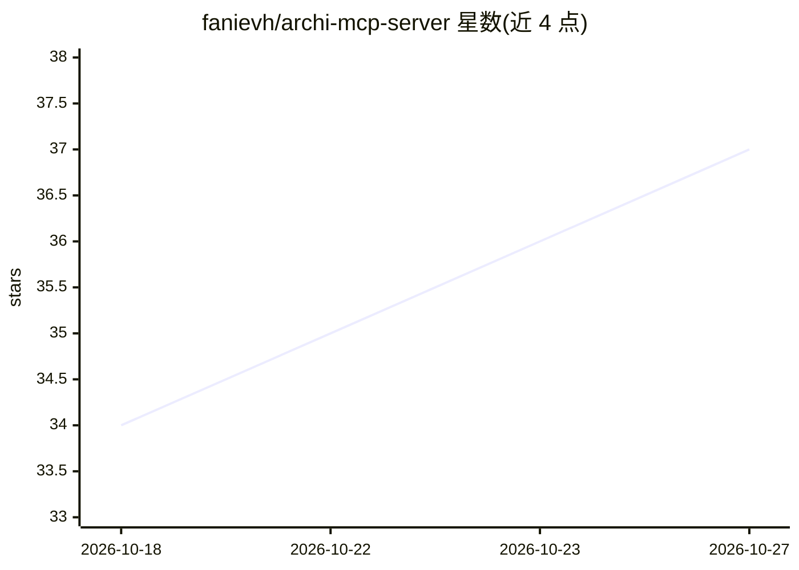

# fanievh/archi-mcp-server

⭐ 37 · Java · MIT · 推送 2026-09-08 · [GitHub](https://github.com/fanievh/archi-mcp-server) · 个人维护

**让 LLM 客户端通过 MCP 查询与修改 ArchiMate 架构模型的 Archi 插件**

Eclipse PDE 插件，嵌入 Archi 内运行 MCP HTTP 服务器（默认 127.0.0.1:18090），使 Claude、Cline、LM Studio 等 MCP 兼容客户端能以自然语言查询、搜索、遍历关系并创建/修改当前打开的 ArchiMate 企业架构模型。提供 70 个 MCP 工具与 14 个含 ArchiMate 参考资料的 MCP 资源；含审批门（变更可排队供人工审核）、可选 TLS 与 bearer token 认证，凭据存于 OS keychain。要求 Archi 5.7+、Java 21+，经 .archiplugin 文件安装；README 建议 LLM 至少 8B 参数、工具调用可靠需 14B+。

## 筛选速览

| 维度 | 判定 | 备注 |
|---|---|---|
| AI 角色 | `ai-ecosystem` | LLM/agent 周边工具 |
| 许可风险 | `permissive` | MIT |
| 部署形态 | `desktop` | 安装包/桌面程序 |
| 模型依赖 | — | README 未给出锁定关系 |
| 硬件要求 | — | 无带数字的原话,不猜 |
| 安装摩擦 | `low` | 无编译、无系统依赖或容器化 |
| 成熟度 | — | 结构信号不足 |

## 能力要点

- 70 个 MCP 工具覆盖查询、搜索、创建、布局、路由、评估与批处理
- 14 个 MCP 资源：ArchiMate 参考资料、工作流指南与视点配方库
- 人工审批模式：agent 变更可排队等待用户决定而非立即生效
- 可选 TLS（自签证书自动生成）与 bearer token 认证，默认仅绑定回环地址

## 适用场景

- 用对话方式查询企业架构模型中的应用依赖与关系
- 让 LLM 客户端创建视图、自动布局与连线
- 在架构治理流程中通过审批门控制 AI 对模型的修改

## 场景标签

`知识图谱` · 领域:知识与检索

## 证据(README 行号)

> L3: An Eclipse PDE plugin for Archi that exposes ArchiMate models through the Model Context Protocol (MCP), enabling LLM
> L7: Archi MCP Server embeds an HTTP server inside Archi that speaks MCP. Once running, any MCP-compatible LLM client (Cl
> L9: The server provides **70 MCP tools** across querying, searching, creating, layout, routing, assessment, batch operat

## 星数曲线

2026-10-18 34 → 2026-10-27 37（+3）

---
*卡片 v1 · prompt 1.4 · 生成 2026-10-25 · 置信度 high · 依据 README sha `044e177d90e8` · [字段定义](../../DATASET.md)*
