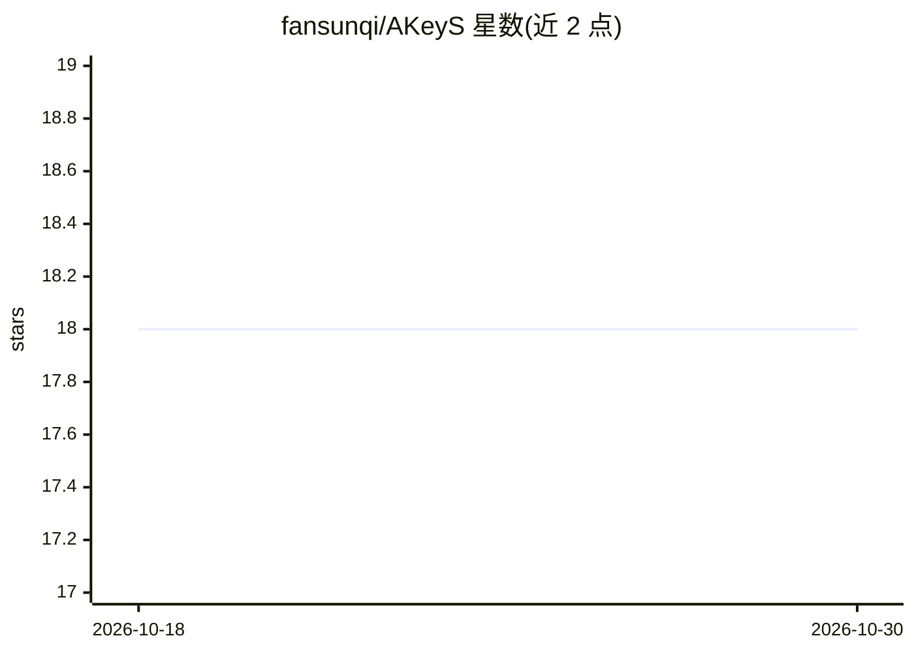

# fansunqi/AKeyS

⭐ 18 · Python · MIT · 推送 2026-06-30 · [GitHub](https://github.com/fansunqi/AKeyS) · [官网](https://arxiv.org/abs/2503.16032) · 个人维护

**用语言代理驱动树搜索挑关键帧做视频问答的算法实现**

论文 Agentic Keyframe Search for Video Question Answering 的官方代码实现：将视频分段组织为树结构，由语言代理估计启发式与移动代价并动态扩展节点，按终止条件判断关键帧收集是否足够后给出回答。提供 demo 脚本与 EgoSchema 数据集的评测流程，NExT-QA 代码尚未发布。依赖 OpenAI API（环境变量 OPENAI_API_KEY/OPENAI_BASE_URL），也提供 LLM 对话缓存以避免 API 费用；README 声明可在无 GPU 的个人电脑上运行。安装方式为 git clone 源码加 pip 依赖。

## 筛选速览

| 维度 | 判定 | 备注 |
|---|---|---|
| AI 角色 | `ai-native` | 本体是模型或模型工具 |
| 许可风险 | `permissive` | MIT |
| 部署形态 | `library` | 以包/库形式分发 |
| 模型依赖 | — | README 未给出锁定关系 |
| 硬件要求 | — | 无带数字的原话,不猜 |
| 安装摩擦 | `low` | 无编译、无系统依赖或容器化 |
| 成熟度 | — | 结构信号不足 |

## 能力要点

- 语言代理引导树搜索识别视频关键帧并回答问题
- 提供 demo 脚本与 EgoSchema 子集/全集评测脚本，输出准确率与平均帧数
- 提供 LLM 对话缓存，可不支付 OpenAI API 费用复现
- README 声明无需 GPU，可在个人电脑运行

## 适用场景

- 复现 EgoSchema 上的视频问答关键帧搜索实验
- 研究者基于代理引导搜索方法做视频问答改进
- 运行 demo 查看关键帧搜索的可视化示例

## 场景标签

`科研工具` `多模态` · 领域:学习与行业

## 证据(README 行号)

> L18: ​	We present **Agentic Keyframe Search (AKeyS)**, a simple yet powerful algorithm for identifying keyframes in the 
> L42:  Obtain an OpenAI API key and set ```OPENAI_API_KEY``` and ```OPENAI_BASE_URL``` as environmental variables in ```~

## 星数曲线



2026-10-18 18 → 2026-10-30 18（+0）


---
*卡片 v1 · prompt 1.4 · 生成 2026-10-29 · 置信度 mid · 依据 README sha `aafc575b5585` · [字段定义](../../DATASET.md)*
