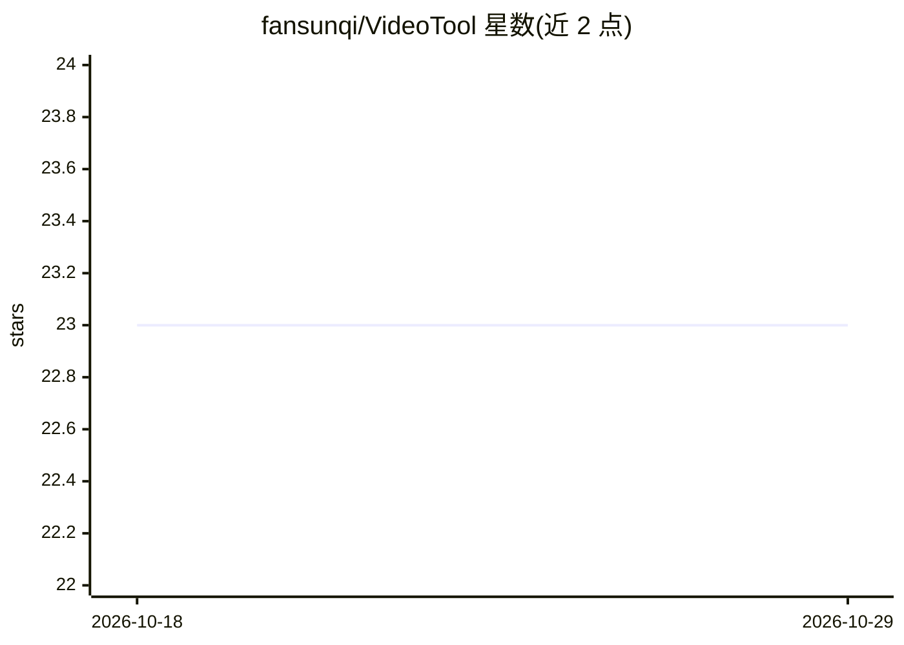

# fansunqi/VideoTool

⭐ 23 · Python · MIT · 推送 2026-09-04 · [GitHub](https://github.com/fansunqi/VideoTool) · [官网](https://arxiv.org/abs/2512.10359) · 个人维护

**NeurIPS'25 论文官方实现：工具增强的视频问答时空推理框架**

NeurIPS 2025 论文 Tool-Augmented Spatiotemporal Reasoning 的官方代码库：为多模态大模型配备可扩展的视频工具集（时间工具：帧选择、时序定位、时序问答；空间工具：目标检测跟踪、图像描述/问答、局部放大；通才工具：视频问答与摘要），并通过 STAR 框架调度时间与空间工具逐步定位视频关键区域。以 GPT-4o 为宿主模型，需配置 OpenAI API key 并另行克隆部署 Grounded-Video-LLM、LLaVA 等子项目。面向视频理解研究者复现论文结果或对单个视频运行问答。

## 筛选速览

| 维度 | 判定 | 备注 |
|---|---|---|
| AI 角色 | `ai-ecosystem` | LLM/agent 周边工具 |
| 许可风险 | `permissive` | MIT |
| 部署形态 | `library` | 以包/库形式分发 |
| 模型依赖 | — | README 未给出锁定关系 |
| 硬件要求 | — | 无带数字的原话,不猜 |
| 安装摩擦 | `low` | 无编译、无系统依赖或容器化 |
| 成熟度 | — | 结构信号不足 |

## 能力要点

- STAR 框架调度时间/空间工具逐步定位视频关键区域
- 论文报告在 VideoMME 提升 8.2%、LongVideoBench 提升 4.6%
- 工具集整合 Grounded-Video-LLM、LLaVA、YOLO、BLIP、Qwen-VL、InternVL 等
- 提供单视频问答与测试用例的运行脚本

## 适用场景

- 复现 NeurIPS'25 论文的视频问答实验
- 对单个视频提问并获得基于工具推理的回答
- 在视频理解研究中扩展或复用时空工具集

## 场景标签

`多模态` `Agent 框架` · 领域:Agent 开发

## 证据(README 行号)

> L6: This repository is the official implementation of Tool-Augmented Spatiotemporal Reasoning for Streamlining Video Que
> L10: In this work, we equip MLLM with a comprehensive and extensible **Video Toolkit**, to enhance MLLM's spatiotemporal

## 星数曲线

2026-10-18 23 → 2026-10-29 23（+0）

---
*卡片 v1 · prompt 1.4 · 生成 2026-10-27 · 置信度 mid · 依据 README sha `e450fefbcced` · [字段定义](../../DATASET.md)*
