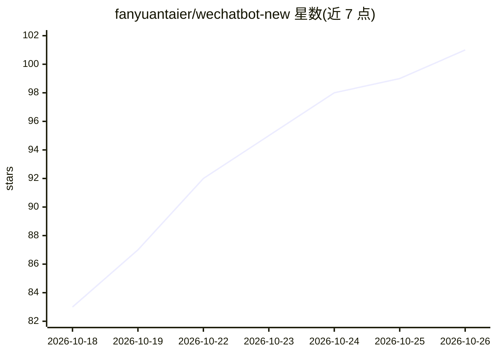

# fanyuantaier/wechatbot-new

⭐ 101 · Python · NOASSERTION · 推送 2026-10-17 · [GitHub](https://github.com/fanyuantaier/wechatbot-new) · [官网](https://pypi.org/project/wechatbot-new/) · 个人维护 · 中文 README

**调用 LLM 自动回复的微信聊天机器人，兼容微信 4.1.12+**

基于 KouriChat 修改的智能微信聊天机器人：底层通过 wechatauto-replica 收发微信消息，调用 DeepSeek、GPT、Gemini 等大语言模型生成回复。支持多用户/群聊独立 Prompt、图片表情识别、情绪识别、网页内容读取、AI 定时任务、联网搜索、角色论坛等功能，提供 WebUI 配置界面。要求 Windows 10/11 与微信 4.1.12.26 及以上已登录。维护者声明因升学更新频率将降低。

## 筛选速览

| 维度 | 判定 | 备注 |
|---|---|---|
| AI 角色 | `ai-native` | 本体是模型或模型工具 |
| 许可风险 | `none` | NOASSERTION |
| 部署形态 | `desktop` | 安装包/桌面程序 |
| 模型依赖 | locked-api |  |
| 硬件要求 | — | 无带数字的原话,不猜 |
| 安装摩擦 | `low` | 无编译、无系统依赖或容器化 |
| 成熟度 | — | 结构信号不足 |

## 能力要点

- 通过 wechatauto-replica 适配微信 4.1.12.26+，支持多用户/群聊独立 Prompt
- 图片/表情识别、情绪识别回复表情包、联网搜索、AI 定时任务
- WebUI 配置：启动程序、修改配置、生成管理 Prompt
- 提供免安装离线包（自带嵌入式 Python 3.12 运行时，解压即用）

## 适用场景

- 让 AI 自动回复微信私聊与群聊消息
- 为不同联系人/群配置不同角色的聊天 Prompt
- 读取聊天记录生成模仿用户风格的话术档案
- 设置 AI 定时提醒任务

## 场景标签

`聊天机器人` · 领域:对话与助手

## 证据(README 行号)

> L15: - 这是一个智能微信聊天机器人。通过wechatauto-replica收发微信消息，调用deepseek、gpt、gemini等大语言模型生成回复消息。
> L55: 1. 智能自动回复，支持多用户/群聊同时聊天，并可为每个用户或群聊分配独立的提示词（Prompt）

## 星数曲线

2026-10-18 83 → 2026-10-26 101（+18）

---
*卡片 v1 · prompt 1.4 · 生成 2026-10-23 · 置信度 high · 依据 README sha `1c64dae2341f` · [字段定义](../../DATASET.md)*
