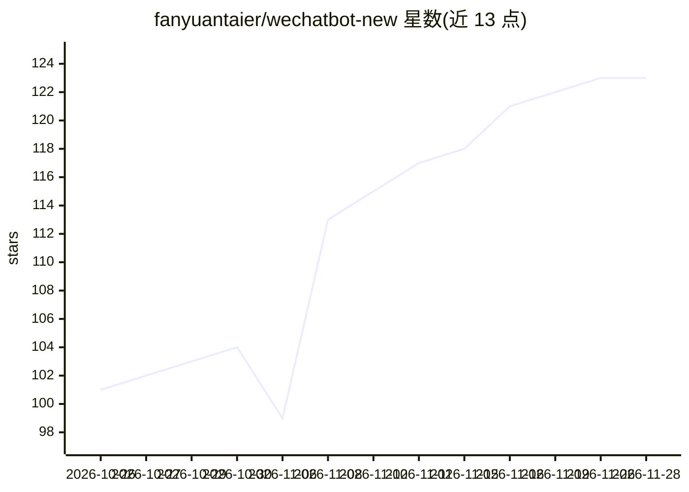

# fanyuantaier/wechatbot-new

⭐ 123 · HTML · NOASSERTION · 推送 2026-11-22 · [GitHub](https://github.com/fanyuantaier/wechatbot-new) · [官网](https://pypi.org/project/wechatbot-new/) · 个人维护 · 中文 README

**微信聊天机器人：接入 LLM 自动收发拟人化消息**

基于 KouriChat 修改的微信聊天机器人，通过 wechatauto-replica 收发微信消息，调用 LLM 生成回复。功能覆盖多用户/群聊独立 Prompt、图片与表情识别、情绪识别回复表情包、记忆总结、AI 定时任务与语音通话提醒、联网搜索、防撤回、朋友圈交互、WebUI 配置与 Prompt 管理。以 Python 包发布，另提供自带 Python 运行时的免安装离线包；需 Windows 10/11 64 位与微信 4.1.12+ 已登录环境。维护者在 README 中声明开学后更新频率将降低。

## 筛选速览

| 维度 | 判定 | 备注 |
|---|---|---|
| AI 角色 | `ai-native` | 本体是模型或模型工具 |
| 许可风险 | `none` | NOASSERTION |
| 部署形态 | `desktop` | 安装包/桌面程序 |
| 模型依赖 | locked-api |  |
| 硬件要求 | — | 无带数字的原话,不猜 |
| 安装摩擦 | `low` | 无编译、无系统依赖或容器化 |
| 成熟度 | — | 结构信号不足 |

## 能力要点

- 多用户/群聊独立 Prompt 与聊天记录生成风格档案
- 图片/表情包/情绪识别与表情包回复
- AI 定时任务、语音通话提醒、联网搜索、防撤回与朋友圈功能
- WebUI 配置与 Prompt 管理，提供免安装离线包

## 适用场景

- 在微信上部署一个拟人化角色陪聊机器人
- 给不同好友或群聊配置不同人格提示词
- 让机器人定时提醒、联网搜索并回复图片消息

## 场景标签

`聊天机器人` · 领域:对话与助手

## 证据(README 行号)

> L15: - 这是一个智能微信聊天机器人。通过wechatauto-replica收发微信消息，调用deepseek、gpt、gemini等大语言模型生成回复消息。
> L56: 1. 智能自动回复，支持多用户/群聊同时聊天，并可为每个用户或群聊分配独立的提示词（Prompt）
> L100: - 本项目基于 KouriChat 修改(原My-Dream-Moments项目)，遵循 **GNU GPL-3.0 或更高版本** 许可证，原项目版权归属：umaru (2025)。

## 星数曲线

2026-10-26 101 → 2026-11-28 123（+22）

---
*卡片 v1 · prompt 1.4 · 生成 2026-11-28 · 置信度 high · 依据 README sha `52acf7cad6a9` · [字段定义](../../DATASET.md)*
