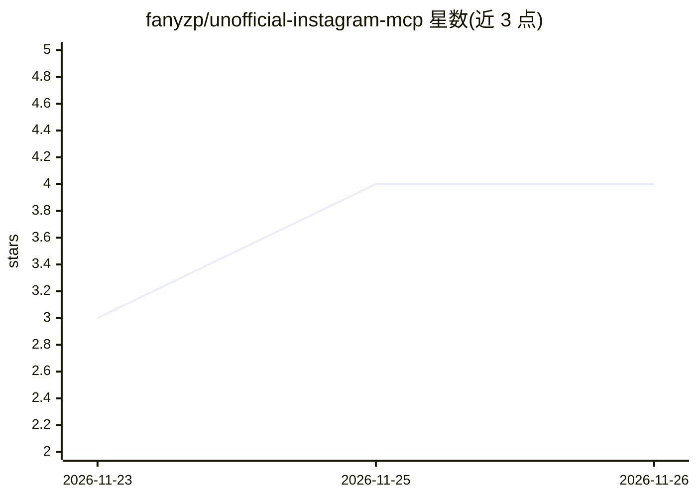

# fanyzp/unofficial-instagram-mcp

⭐ 4 · JavaScript · MIT · 推送 2026-11-19 · [GitHub](https://github.com/fanyzp/unofficial-instagram-mcp) · 个人维护

**给 AI agent 提供 Instagram 消息/主页/帖子操作工具的 MCP 服务器**

非官方的 Instagram Web MCP 服务器，通过已登录的 Chrome（CDP 远程调试）操作可见网页界面，不调用 Meta API、不存储密码。提供约 40 个工具：DM 收发与后台 watcher、主页/粉丝/关注/帖子/评论/快拍读取、点赞/保存/关注/发帖/删帖等写操作，另有 CLI 与 TUI 两种直接调用方式。写操作支持 dryRun 模式；随仓库附带 Agent Skill 文件，通过渐进式披露向 agent 提供使用说明与安全规则；安装器可注册到 16 种 agent harness。

## 筛选速览

| 维度 | 判定 | 备注 |
|---|---|---|
| AI 角色 | `ai-ecosystem` | LLM/agent 周边工具 |
| 许可风险 | `permissive` | MIT |
| 部署形态 | `library` | 以包/库形式分发 |
| 模型依赖 | — | README 未给出锁定关系 |
| 硬件要求 | — | 无带数字的原话,不猜 |
| 安装摩擦 | `low` | 无编译、无系统依赖或容器化 |
| 成熟度 | — | 结构信号不足 |

## 能力要点

- 通过已登录 Chrome 操作 Instagram Web，不使用 Meta API
- DM watcher 监控收件箱并推送 MCP 通知
- 写工具支持 dryRun 模式与内置 selftest（读取级/完整级）
- 安装器支持 16 种 harness，同时注册 MCP 服务器并安装 Agent Skill

## 适用场景

- 让 agent 自动检查并回复 Instagram 私信
- 用自然语言让 agent 查主页、浏览 feed、搜索用户和标签
- 通过 agent 批量执行点赞、保存、发帖等操作
- 用 CLI/TUI 直接测试各项 Instagram 操作

## 场景标签

`浏览器自动化` · 领域:效率与自动化

## 证据(README 行号)

> L9: An unofficial Model Context Protocol (MCP) server for Instagram Web. It gives an AI agent a set of focused tools for
> L15: One command installs everything into your agent: it registers the MCP server and installs the Agent Skill. Pick you

## 星数曲线

2026-11-23 3 → 2026-11-26 4（+1）

---
*卡片 v1 · prompt 1.4 · 生成 2026-11-23 · 置信度 high · 依据 README sha `3a57e9e80a48` · [字段定义](../../DATASET.md)*
