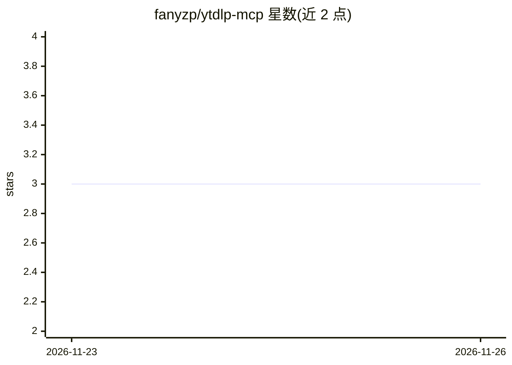

# fanyzp/ytdlp-mcp

⭐ — · [GitHub]() · 个人维护

**MCP 服务器：让 AI agent 用自然语言下载与转换视频/音频**

基于 Node 的 MCP 服务器，封装 yt-dlp 与 FFmpeg，向 AI agent 提供 12 个工具：读取视频元信息、列出可用格式、下载视频、提取音频（Opus/MP3/M4A）、获取字幕、批量下载、播放列表/频道枚举、YouTube/SoundCloud 搜索以及本地视频转码。通过 OpenCode、Gem CLI、Claude Code 等以 `/ytdlp-mcp` 命令调用，或把 PROMPT.md 交给任意 agent 让其代为安装。依赖 yt-dlp、ffmpeg 与 Node 18，MIT 许可。

## 筛选速览

| 维度 | 判定 | 备注 |
|---|---|---|
| AI 角色 | `ai-ecosystem` | LLM/agent 周边工具 |
| 许可风险 | `permissive` | — |
| 部署形态 | `None` |  |
| 模型依赖 | — | README 未给出锁定关系 |
| 硬件要求 | — | 无带数字的原话,不猜 |
| 安装摩擦 | `medium` | 含编译或系统依赖之一 |
| 成熟度 | — | 结构信号不足 |

## 能力要点

- 12 个 MCP 工具覆盖探测、下载、字幕、批量队列与转码
- 搜索仅暴露经验证可用的 yt-dlp 前缀（ytsearch/scsearch），返回纯元数据 1-50 条
- 环境变量可配置下载目录、cookies 文件与 yt-dlp/ffmpeg 二进制路径
- 支持将 PROMPT.md 交给 AI agent 自动完成安装

## 适用场景

- 在 Claude Code 等 CLI 中用自然语言让 agent 下载视频
- 批量下载播放列表或频道条目
- 从本地视频转码为预设格式或抽取音频

## 场景标签

 · 领域:媒体工具/LLM 基础设施

## 证据(README 行号)

> L10:  An MCP server that lets AI agents inspect, download, and convert video and audio using yt-dlp and FFmpeg through n
> L24: Requires `yt-dlp`, `ffmpeg`, Node 18. Or copy PROMPT.md into any AI agent and let it install for you.

## 星数曲线

2026-11-23 3 → 2026-11-26 3（+0）

---
*卡片 v1 · prompt 1.4 · 生成 2026-11-23 · 置信度 high · 依据 README sha `a6e3f6a1c234` · [字段定义](../../DATASET.md)*
