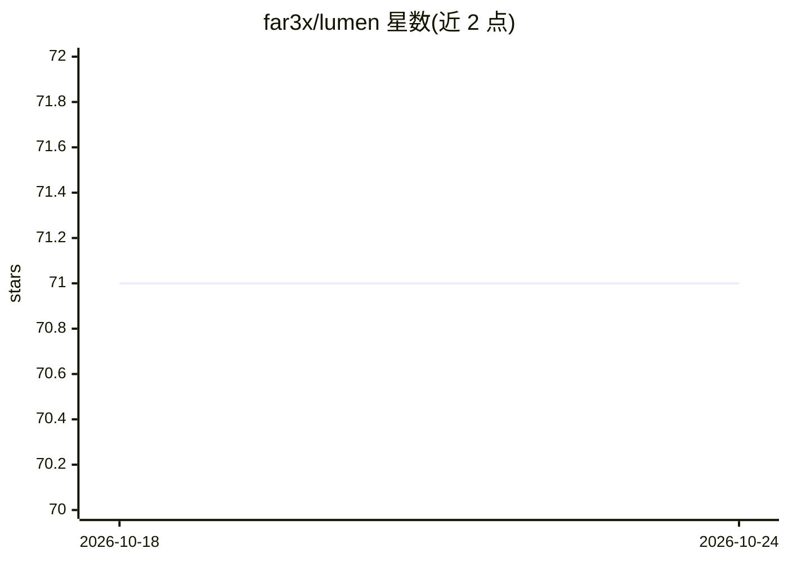

# far3x/lumen

⭐ 71 · Python · MIT · 推送 2025-10-29 · [GitHub](https://github.com/far3x/lumen) · [官网](https://lumen.onl/) · 组织维护

**Lumen Protocol 官方 CLI：代码转 LLM 提示词并向网络提交**

Lumen Protocol 的官方命令行客户端，包含两类命令：网络命令用于设备授权登录、将当前项目经分析与清理后提交到 Lumen 网络、查看最近 10 次贡献记录与登出；本地提示词生成命令不联网，可将当前目录或公开 GitHub 仓库组装为提示词并复制到剪贴板或保存为 .txt 文件，还能列出最消耗 token 的文件排行。通过 pip 从 PyPI 安装，配置存储于 config.json 并提供编辑、重置与单项设置命令。面向参与 Lumen 网络的开发者。

## 筛选速览

| 维度 | 判定 | 备注 |
|---|---|---|
| AI 角色 | `ai-ecosystem` | LLM/agent 周边工具 |
| 许可风险 | `permissive` | MIT |
| 部署形态 | `library` | 以包/库形式分发 |
| 模型依赖 | — | README 未给出锁定关系 |
| 硬件要求 | — | 无带数字的原话,不猜 |
| 安装摩擦 | `low` | 无编译、无系统依赖或容器化 |
| 成熟度 | — | 结构信号不足 |

## 能力要点

- 将当前目录或 GitHub 公开仓库组装为 LLM 提示词（剪贴板或文件）
- token 消耗文件排行（默认前 20）
- contribute 命令将项目经分析与清理后提交至 Lumen 网络
- 本地生成命令不向网络发送数据

## 适用场景

- 把整个代码库快速打包成提示词供 LLM 使用
- 查看项目中哪些文件最消耗 token
- 向 Lumen 网络提交代码贡献并追踪记录

## 场景标签

`提示工程` · 领域:Agent 开发

## 证据(README 行号)

> L3:  The official CLI for the Lumen Protocol & Local Prompt Generation.
> L56: ### Local Prompt Generation

## 星数曲线

2026-10-18 71 → 2026-10-24 71（+0）

---
*卡片 v1 · prompt 1.4 · 生成 2026-10-24 · 置信度 mid · 依据 README sha `60a20e0b0078` · [字段定义](../../DATASET.md)*
