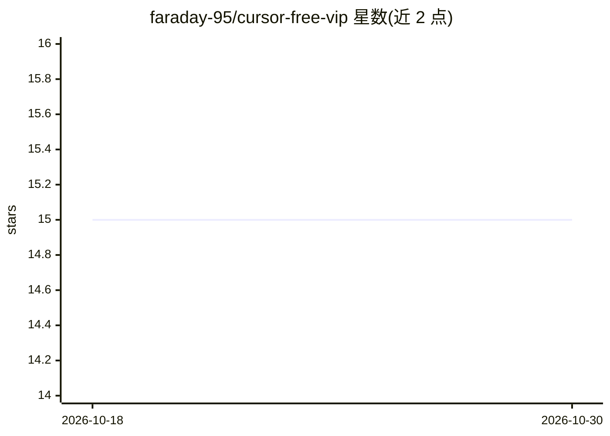

# faraday-95/cursor-free-vip

⭐ 15 · Python · NOASSERTION · 推送 2026-10-13 · [GitHub](https://github.com/faraday-95/cursor-free-vip) · [官网](https://faraday-95.github.io) · 个人维护

**自动化 Cursor 账号注册与试用管理的工具**

面向 Cursor IDE（AI 代码编辑器）用户的账号管理工具：支持自定义邮箱自动化账号注册，并支持 Google 与 GitHub 登录方式。README 主体内容在可见窗口内被截断，仅能确认其定位为 Cursor 的账号/注册流程自动化工具，具体运行机制、支持平台与安装方式无法从可见行核实。仓库主题标签涉及 android、desktop-app、electron-app、beta、free-trial-helper 等，暗示覆盖桌面与安卓平台并处于 beta 阶段，但此为标签信息而非 README 正文。

## 筛选速览

| 维度 | 判定 | 备注 |
|---|---|---|
| AI 角色 | `ai-ecosystem` | LLM/agent 周边工具 |
| 许可风险 | `none` | NOASSERTION |
| 部署形态 | `None` |  |
| 模型依赖 | — | README 未给出锁定关系 |
| 硬件要求 | — | 无带数字的原话,不猜 |
| 安装摩擦 | `low` | 无编译、无系统依赖或容器化 |
| 成熟度 | — | 结构信号不足 |

## 能力要点

- 自定义邮箱自动化账号注册
- 支持 Google 与 GitHub 登录

## 适用场景

- 自动化完成 Cursor 的账号注册流程

## 场景标签

 · 领域:开发者工具/AI IDE 辅助

## 证据(README 行号)

> L2: # 🚀 cursor-free-vip - Automate Your Cursor Management Effortlessly
> L5: …（65 行代码略）

## 星数曲线

2026-10-18 15 → 2026-10-30 15（+0）

---
*卡片 v1 · prompt 1.4 · 生成 2026-10-30 · 置信度 low · 依据 README sha `4d565c077f95` · [字段定义](../../DATASET.md)*
