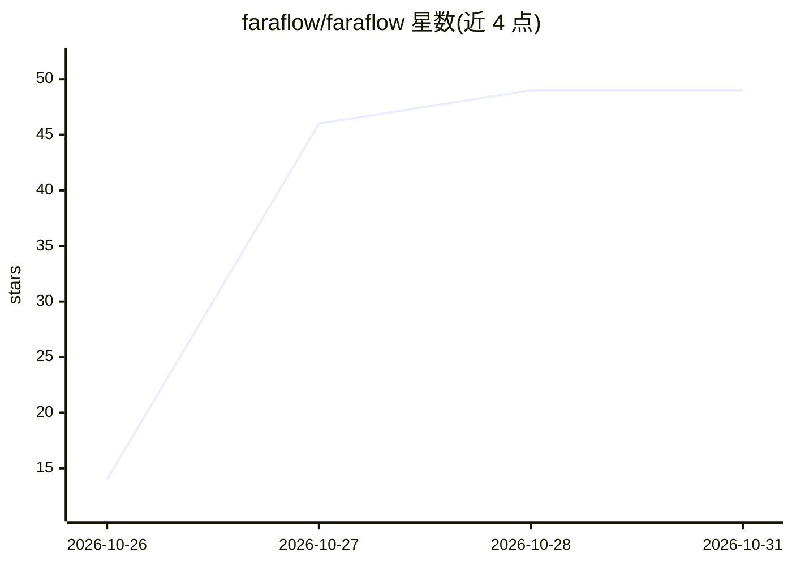

# faraflow/faraflow

⭐ 49 · Python · NOASSERTION · 推送 2026-10-27 · [GitHub](https://github.com/faraflow/faraflow) · [官网](https://faraflow.ai) · 组织维护

**面向业务的 AI agent 可视化工作流构建与执行引擎**

提供画布式可视化工作室与工作流执行引擎：用户在画布上编排 agent 的步骤，保存为版本化工作流，在自有基础设施（Docker）上运行。工作流可混合 LLM 调用与 Python 代码；每次运行按节点记录输入、输出与错误，支持从失败处继续或重试，并提供仪表盘与内置模板。安装需 Docker 与 Docker Compose，克隆仓库后配置 .env（实例 API key 与 OpenAI key），通过 docker compose 启动。采用 Fair Core License（FCL-1.0-ALv2），属 Fair Source 许可。

## 筛选速览

| 维度 | 判定 | 备注 |
|---|---|---|
| AI 角色 | `ai-ecosystem` | LLM/agent 周边工具 |
| 许可风险 | `none` | NOASSERTION |
| 部署形态 | `self-host` | docker 或自建部署 |
| 模型依赖 | — | README 未给出锁定关系 |
| 硬件要求 | — | 无带数字的原话,不猜 |
| 安装摩擦 | `low` | 无编译、无系统依赖或容器化 |
| 成熟度 | — | 结构信号不足 |

## 能力要点

- 画布式可视化工作流编辑，含内置模板
- 工作流可混合 LLM 调用与 Python 代码
- 节点级运行追踪（输入/输出/错误）与失败续跑/重试
- 以 Docker Compose 在自有基础设施上运行

## 适用场景

- 在画布上编排并版本化管理业务 agent 工作流
- 测试与对比多次运行、逐步骤解释 agent 行为
- 在自有服务器上运行和监控 LLM 工作流

## 场景标签

`工作流自动化` · 领域:效率与自动化

## 证据(README 行号)

> L5: Faraflow is a visual studio and a workflow engine for business-grade AI agents. You lay out an agent's steps on a ca
> L55: - Run workflows that mix LLM calls and Python code.

## 星数曲线

2026-10-26 14 → 2026-10-31 49（+35）

---
*卡片 v1 · prompt 1.4 · 生成 2026-10-27 · 置信度 high · 依据 README sha `b0497ef81a03` · [字段定义](../../DATASET.md)*
