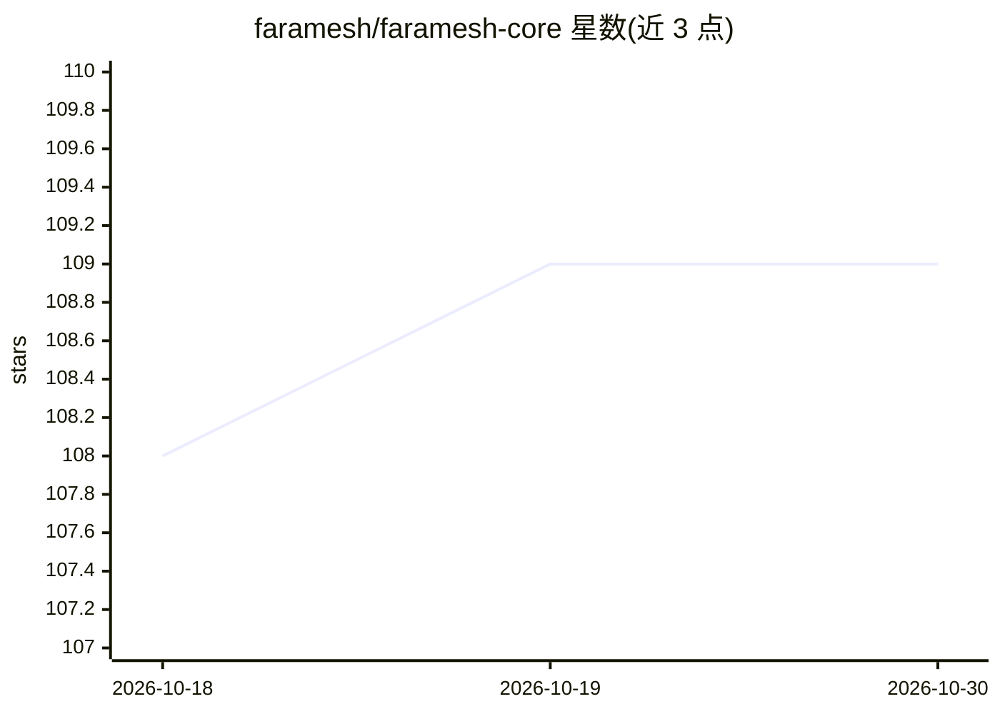

# faramesh/faramesh-core

⭐ 109 · Go · Apache-2.0 · 推送 2026-07-21 · [GitHub](https://github.com/faramesh/faramesh-core) · [官网](https://docs.faramesh.dev/) · 组织维护

**AI agent 工具调用的治理即代码层：声明式策略+本地守护进程**

面向在生产环境运行 AI agent 的工程师的治理工具：以 governance.fms 文件声明权限策略，本地守护进程在每个工具调用执行前做出允许/延迟/拒绝的确定性判定（决策路径不含 LLM），决策记录以哈希链 WAL 存证，可选 KMS 签名。支持 SPIFFE/OIDC/云工作负载身份绑定并在调用点代理凭证。通过 SDK shim、MCP proxy、HTTP proxy 或 A2A 接入 13 种框架（LangGraph、CrewAI、AutoGen 等），无需云端。

## 筛选速览

| 维度 | 判定 | 备注 |
|---|---|---|
| AI 角色 | `ai-ecosystem` | LLM/agent 周边工具 |
| 许可风险 | `permissive` | Apache-2.0 |
| 部署形态 | `library` | 以包/库形式分发 |
| 模型依赖 | — | README 未给出锁定关系 |
| 硬件要求 | — | 无带数字的原话,不猜 |
| 安装摩擦 | `low` | 无编译、无系统依赖或容器化 |
| 成熟度 | — | 结构信号不足 |

## 能力要点

- 声明式策略文件（FPL）+ 本地守护进程逐调用强制执行
- 决策路径为纯函数，不含 LLM，结果确定性
- 哈希链 WAL 审计日志与可选 KMS 签名
- 通过 SDK shim/MCP proxy/HTTP proxy/A2A 接入 13 种框架

## 适用场景

- 生产环境 agent 的工具调用权限治理与默认拒绝
- 外部邮件转人工审批、消费上限等策略落地
- 为 agent 工具调用生成防篡改的审计记录

## 场景标签

`网络安全` · 领域:学习与行业

## 证据(README 行号)

> L5: Declare permissions in `governance.fms`. A local daemon permits, defers, or denies each tool call before it runs. De
> L35: - **Deterministic decisions.** Pure functions over policy and the action payload. No LLM in the decision path.
> L36: - **Non-bypassable enforcement.** Local daemon. Every tool call goes through it. No SDK to forget to wrap.

## 星数曲线

2026-10-18 108 → 2026-10-30 109（+1）

---
*卡片 v1 · prompt 1.4 · 生成 2026-10-23 · 置信度 high · 依据 README sha `1fe6aa3136eb` · [字段定义](../../DATASET.md)*
