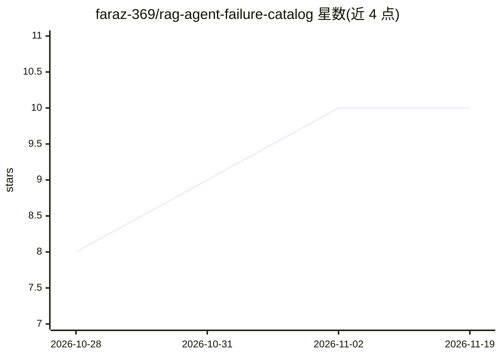

# faraz-369/rag-agent-failure-catalog

⭐ 10 · Python · MIT · 推送 2026-11-12 · [GitHub](https://github.com/faraz-369/rag-agent-failure-catalog) · 个人维护

**RAG/AI agent 静默失效模式目录：附复现、检测与缓解代码**

将 RAG 与 agent 系统中 10 类常见静默失效（无依据回答、引用漂移、工具调用循环、提前终止、数值幻觉等）工程化为目录条目：每条包含 README 说明、reproduce.py 按需触发、detect.py 检测器与小型评估、mitigate.py 缓解护栏。默认离线模式用确定性 stub 模拟失效，零依赖、无需 API key；6 类条目支持 --live 接真实模型。检测器为词法基线（token overlap、正则），作者声明需在自有标注数据上校准阈值。

## 筛选速览

| 维度 | 判定 | 备注 |
|---|---|---|
| AI 角色 | `ai-ecosystem` | LLM/agent 周边工具 |
| 许可风险 | `permissive` | MIT |
| 部署形态 | `library` | 以包/库形式分发 |
| 模型依赖 | — | README 未给出锁定关系 |
| 硬件要求 | — | 无带数字的原话,不猜 |
| 安装摩擦 | `low` | 无编译、无系统依赖或容器化 |
| 成熟度 | — | 结构信号不足 |

## 能力要点

- 10 类静默失效各含 reproduce/detect/mitigate 四件套文件
- 离线 stub 模式零依赖、无需 API key，1 秒内可复现
- 支持 --live 接 OpenAI/Anthropic 模型实测
- 每个 detect.py 内置 evaluate() 可校验检测器替换

## 适用场景

- 为 RAG 系统搭建评测基线并量化静默失效率
- 团队复现并检测生产环境中的无依据回答与工具循环
- 参考其缓解护栏模式改造现有 LLM 应用

## 场景标签

`模型评测` · 领域:评测与运维

## 证据(README 行号)

> L7: A catalog of common, expensive *silent* failures in RAG systems and AI agents, each with a minimal reproduction, a d
> L109: 3. **Detection is the main deliverable.** A mitigation you cannot measure is a hope. Each entry has a detector and

## 星数曲线

2026-10-28 8 → 2026-11-19 10（+2）

---
*卡片 v1 · prompt 1.4 · 生成 2026-11-19 · 置信度 high · 依据 README sha `fa0f39845bf0` · [字段定义](../../DATASET.md)*
