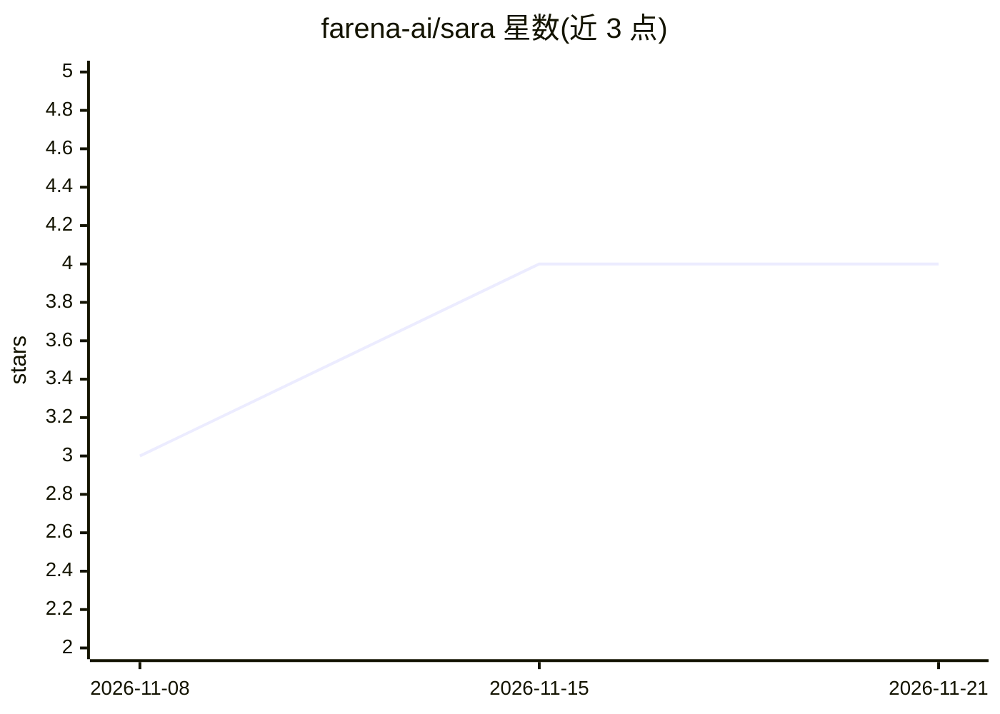

# farena-ai/sara

⭐ 4 · TypeScript · MIT · 推送 2026-11-20 · [GitHub](https://github.com/farena-ai/sara) · [官网](https://www.backstagecoding.com) · 组织维护

**自托管 AI 陪伴与编程搭档：自带记忆、语音与工具审批**

自托管的开源 AI 陪伴应用，面向个人与团队，提供可定制性格与记忆的对话伙伴、可打断的语音与视频通话、待办/提醒/日程规划、文档阅读（含 PDF 扫描件并标注出处页码）、共享角色扮演场景，以及带沙盒与审批卡的编程工作区。支持家庭模式与带 passkey、角色和共享工作区的独立商业安装。可接入本地或云端模型，跨 Web、Windows、macOS、Android、Telegram 等多端使用，MIT 许可。

## 筛选速览

| 维度 | 判定 | 备注 |
|---|---|---|
| AI 角色 | `ai-native` | 本体是模型或模型工具 |
| 许可风险 | `permissive` | MIT |
| 部署形态 | `self-host` | docker 或自建部署 |
| 模型依赖 | local-ok | 支持本地模型 |
| 硬件要求 | — | 无带数字的原话,不猜 |
| 安装摩擦 | `low` | 无编译、无系统依赖或容器化 |
| 成熟度 | — | 结构信号不足 |

## 能力要点

- 编程工作区带沙盒执行、审批卡与'所说与所做'一致性检查
- 本地模型（Ollama/vLLM/llama.cpp）与云模型均可接入，本地模式数据不出机
- 多端接入：Web/PWA、Windows/macOS 应用、Android、Telegram/Discord/Signal 等
- 签名的 Sara Store 提供 MCP 工具服务器与插件，默认关闭需手动启用

## 适用场景

- 在自己服务器上搭建可记忆、可语音通话的 AI 陪伴
- 让 AI 在沙盒中读写代码、执行命令并展示 diff 与测试结果
- 团队通过独立商业安装使用带角色权限的共享工作区
- 用本地模型处理 PDF 与文档并保留出处引用

## 场景标签

`AI 助手` `聊天机器人` `语音 Agent` `编码 Agent` · 领域:编码与开发

## 证据(README 行号)

> L5:  Sara is a self-hosted AI companion with a personality you shape and memory you control, and a real coding harness t
> L95: |**Privacy, local models and safety**|Any model: local (Ollama, vLLM, llama.cpp), cloud (OpenAI, Anthropic, xAI, Op

## 星数曲线

2026-11-08 3 → 2026-11-21 4（+1）

---
*卡片 v1 · prompt 1.4 · 生成 2026-11-21 · 置信度 high · 依据 README sha `81ec4a6eafa5` · [字段定义](../../DATASET.md)*
