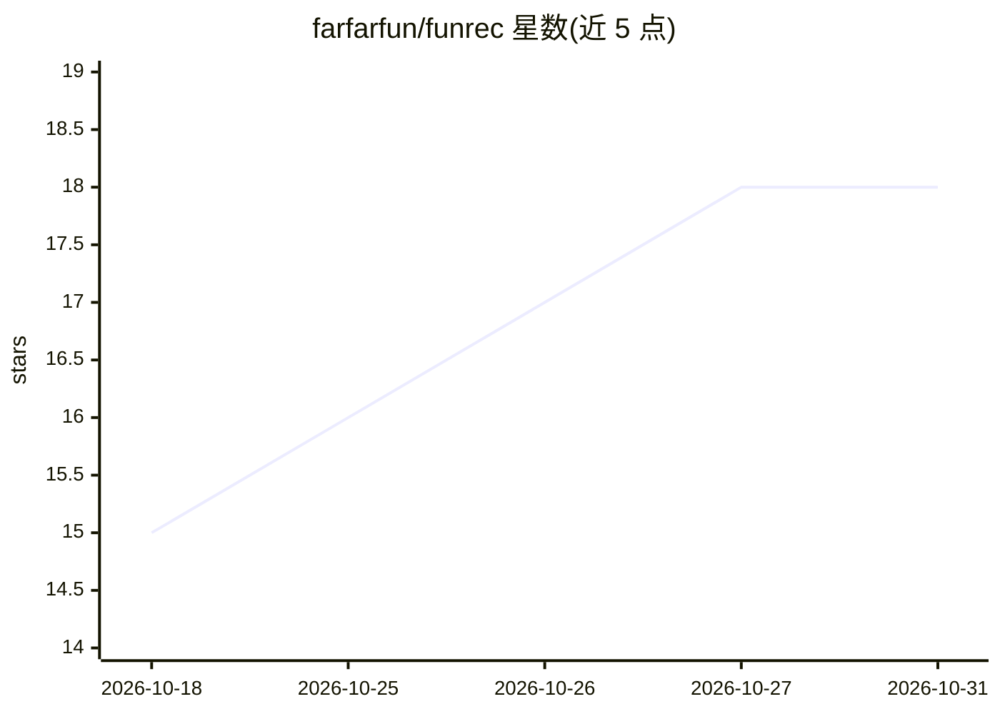

# farfarfun/funrec

⭐ 18 · Python · MIT · 推送 2026-10-11 · [GitHub](https://github.com/farfarfun/funrec) · [官网](https://pypi.org/project/funrec/) · 组织维护 · 中文 README

**PyTorch 推荐系统与 CTR 预估模型库**

基于 PyTorch 的深度学习推荐模型与特征工程工具集，提供 CTR 模型（如 DeepFM）、特征列（DenseFeat/SparseFeat）和常用网络层，按论文年份组织的模型实现，部分代码移植自 DeepCTR-Torch。通过 pip 安装，examples/ 目录提供训练示例（需额外安装 funrec[examples]），MIND 模型训练与召回评估需 faiss/matplotlib（funrec[mind]）。面向推荐系统方向的开发者与科研人员。

## 筛选速览

| 维度 | 判定 | 备注 |
|---|---|---|
| AI 角色 | `ai-native` | 本体是模型或模型工具 |
| 许可风险 | `permissive` | MIT |
| 部署形态 | `library` | 以包/库形式分发 |
| 模型依赖 | — | README 未给出锁定关系 |
| 硬件要求 | — | 无带数字的原话,不猜 |
| 安装摩擦 | `low` | 无编译、无系统依赖或容器化 |
| 成熟度 | — | 结构信号不足 |

## 能力要点

- 提供 DeepFM 等 CTR 模型与特征列、网络层组件
- examples/ 目录含训练示例，脚本按自身路径解析数据
- MIND 模型训练与召回评估可选安装 faiss/matplotlib

## 适用场景

- 搭建与训练 CTR 预估模型
- 学习推荐系统模型实现与复现论文方法
- 复用特征输入与网络层组件做推荐实验

## 场景标签

`推荐系统` · 领域:学习与行业

## 证据(README 行号)

> L3: `funrec` 是基于 PyTorch 的深度学习推荐模型与特征工程工具集，提供 CTR 模型、特征列和常用网络层。
> L17: from funrec.models import DeepFM

## 星数曲线

2026-10-18 15 → 2026-10-31 18（+3）

---
*卡片 v1 · prompt 1.4 · 生成 2026-10-29 · 置信度 high · 依据 README sha `7fd6dab03593` · [字段定义](../../DATASET.md)*
