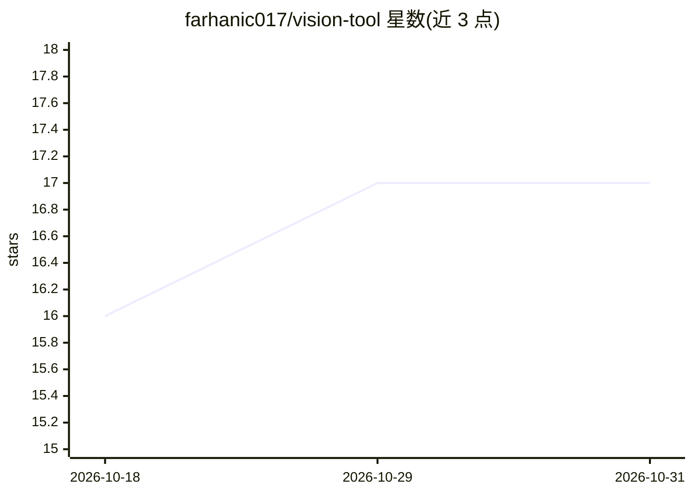

# farhanic017/vision-tool

⭐ 17 · Python · GPL-3.0 · 推送 2026-10-12 · [GitHub](https://github.com/farhanic017/vision-tool) · [官网](https://github.com/farhanic017/vision-tool) · 个人维护

**为 AI 编码助手和本地 LLM 提供图像/视频理解的 MCP 视觉服务器**

以 MCP 服务器形式运行的视觉工具：向 Claude Desktop/Code、Cursor、OpenCode、VS Code、Ollama、LM Studio、llama.cpp 等客户端暴露 analyze_image / analyze_video 两个 MCP 工具，也可作 CLI、OpenCode skill 或 Python 库使用，让纯文本模型获得图像与视频描述能力。后端路由覆盖 23 个视觉模型（Gemini 优先、Azure/Groq/HuggingFace/Mistral/Fireworks/ZAI 并行兜底，首个成功即返回）。限制：图像缩至 1024px、视频仅取 8 关键帧（依赖 ffmpeg）；至少需配置一个后端 API key；提供 always-on 看门狗进程自动启停。

## 筛选速览

| 维度 | 判定 | 备注 |
|---|---|---|
| AI 角色 | `ai-ecosystem` | LLM/agent 周边工具 |
| 许可风险 | `viral` | GPL-3.0 |
| 部署形态 | `desktop` | 安装包/桌面程序 |
| 模型依赖 | local-ok | 支持本地模型 |
| 硬件要求 | — | 无带数字的原话,不猜 |
| 安装摩擦 | `medium` | 含编译或系统依赖之一 |
| 成熟度 | — | 结构信号不足 |

## 能力要点

- analyze_image / analyze_video 作为标准 MCP 工具暴露给任意兼容客户端
- 23 个视觉后端并行回退链，典型分析 2-5 秒
- 支持本地 LLM（Ollama/LM Studio/llama.cpp）调用而无需更换本地模型
- always-on 模式：监视 13 种 AI 工具进程并自动启停视觉服务器

## 适用场景

- 让纯文本编码助手（Claude Code、Cursor 等）能分析截图和 UI 图
- 给本地 Ollama/LM Studio 模型补上图像理解能力
- 把屏幕录制、MP4 视频转成关键帧文本描述供 agent 推理

## 场景标签

`多模态` `图像视频处理` `模型网关` · 领域:Agent 开发

## 证据(README 行号)

> L22: It works as a **Model Context Protocol (MCP) server**, CLI tool, OpenCode skill,
> L33: - **Works with MCP** - exposes `analyze_image` and `analyze_video` as standard
> L88: 2. **The MCP server** (`vision_mcp_server.py`) exposes `analyze_image` and

## 星数曲线

2026-10-18 16 → 2026-10-31 17（+1）

---
*卡片 v1 · prompt 1.4 · 生成 2026-10-29 · 置信度 high · 依据 README sha `953c84930228` · [字段定义](../../DATASET.md)*
