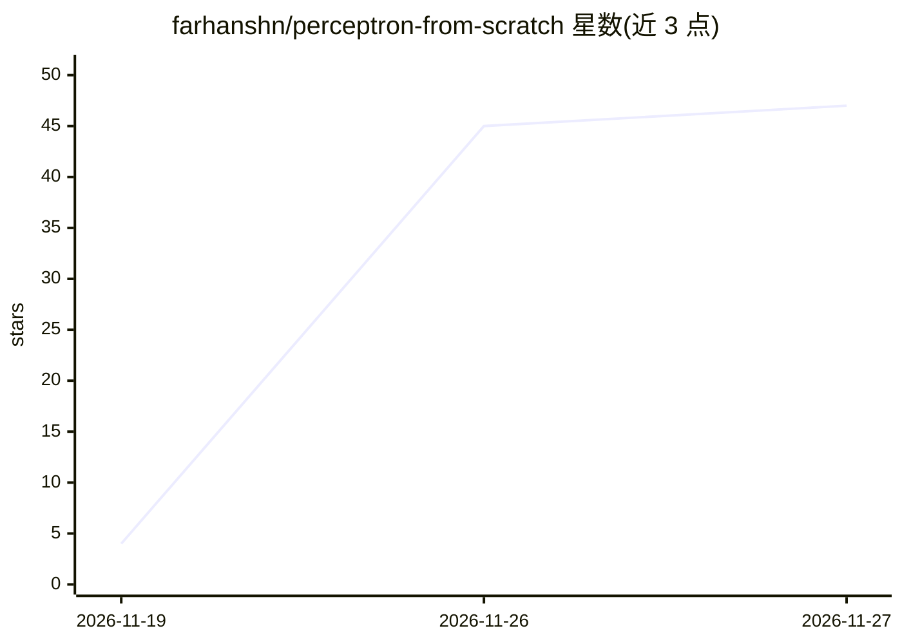

# farhanshn/perceptron-from-scratch

⭐ 47 · Jupyter Notebook · MIT · 推送 2026-11-15 · [GitHub](https://github.com/farhanshn/perceptron-from-scratch) · 个人维护

**纯 Python 从零实现感知算法并与 scikit-learn 对比**

学习型项目：用纯 Python 实现感知机算法，给出前向计算公式（z = w·x + b，阈值判类）与更新规则（w += learning_rate * (y - prediction) * x），并与 scikit-learn 的实现做对比。以 Jupyter notebook 形式组织，运行需通过 pip 安装 numpy、matplotlib、scikit-learn 与 jupyter。适合用于理解感知机的基本原理。

## 筛选速览

| 维度 | 判定 | 备注 |
|---|---|---|
| AI 角色 | `ai-knowledge` | 知识聚合/清单类 |
| 许可风险 | `permissive` | MIT |
| 部署形态 | `library` | 以包/库形式分发 |
| 模型依赖 | — | README 未给出锁定关系 |
| 硬件要求 | — | 无带数字的原话,不猜 |
| 安装摩擦 | `low` | 无编译、无系统依赖或容器化 |
| 成熟度 | — | 结构信号不足 |

## 能力要点

- 纯 Python 从零实现感知机，含前向计算与权重更新规则
- 与 scikit-learn 的实现进行对比
- 以 Jupyter notebook 形式提供

## 适用场景

- 学习感知机算法的数学原理与实现细节
- 对照 scikit-learn 验证自己实现的正确性
- 作为机器学习入门的教学示例

## 场景标签

`教程课程` · 领域:学习与行业

## 证据(README 行号)

> L3: Learning project: implementing the perceptron algorithm in pure Python,
> L4: then comparing it with scikit-learn's implementation.

## 星数曲线

2026-11-19 4 → 2026-11-27 47（+43）

---
*卡片 v1 · prompt 1.4 · 生成 2026-11-21 · 置信度 high · 依据 README sha `e83cb4de5c59` · [字段定义](../../DATASET.md)*
