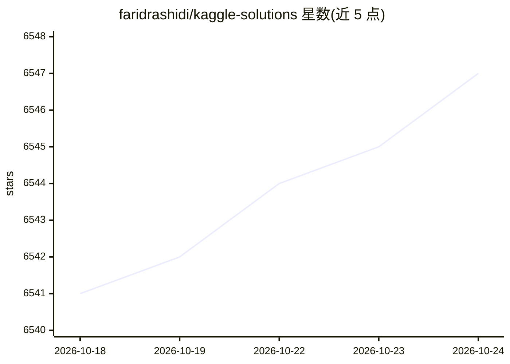

# faridrashidi/kaggle-solutions

⭐ 6,546 · Astro · MIT · 推送 2026-10-06 · [GitHub](https://github.com/faridrashidi/kaggle-solutions) · [官网](https://kaggle.farid.one) · 个人维护

**Kaggle 竞赛获奖方案与思路的策展清单网站**

策展 Kaggle 数百场竞赛的获胜方案、讨论帖、代码 Notebook 与学习资源，按计算机视觉、NLP、表格、时间序列等类别组织，配套在线网站 kaggle.farid.one 可浏览与搜索。仓库本身是一个 Astro 静态站点，可 Fork 自用、通过 npm 本地运行，竞赛档案存于 data/competitions.yml 并由 scripts/ 脚本维护更新。面向 Kaggle 竞赛学习者与参赛者，接受社区以 PR 方式补充缺失方案。

## 筛选速览

| 维度 | 判定 | 备注 |
|---|---|---|
| AI 角色 | `ai-knowledge` | 知识聚合/清单类 |
| 许可风险 | `permissive` | MIT |
| 部署形态 | `library` | 以包/库形式分发 |
| 模型依赖 | — | README 未给出锁定关系 |
| 硬件要求 | — | 无带数字的原话,不猜 |
| 安装摩擦 | `low` | 无编译、无系统依赖或容器化 |
| 成熟度 | — | 结构信号不足 |

## 能力要点

- 收录数百场竞赛的获胜方案、讨论帖与代码 Notebook
- 按 CV/NLP/表格/时间序列等类别组织并提供在线网站检索
- Astro 静态站点可 Fork 定制并部署到 Cloudflare Pages/Netlify/Vercel
- 竞赛数据以 competitions.yml 维护，脚本可持续更新

## 适用场景

- 学习往届 Kaggle 竞赛获胜者的建模思路
- 按技术领域检索竞赛方案与实现代码
- Fork 仓库建立个人的竞赛学习笔记库

## 场景标签

`精选清单` · 领域:学习与行业

## 证据(README 行号)

> L22: This repository is a curated collection of **solutions, ideas, and insights** from top performers across hundreds o
> L24: - **Winning Solutions**: Detailed approaches from competition winners and top finishers

## 星数曲线

2026-10-18 6,541 → 2026-10-24 6,547（+6）

---
*卡片 v1 · prompt 1.4 · 生成 2026-10-20 · 置信度 high · 依据 README sha `60e42fccd189` · [字段定义](../../DATASET.md)*
