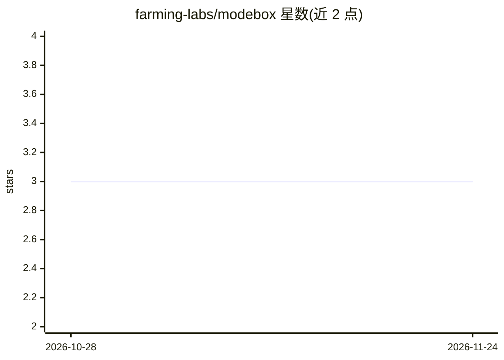

# farming-labs/modebox

⭐ 3 · Rust · MIT · 推送 2026-11-14 · [GitHub](https://github.com/farming-labs/modebox) · [官网](https://modebox.farming-labs.dev) · 组织维护

**为 AI agent 提供 WebAssembly 沙箱，可安全执行工具调用脚本**

modebox 将 agent 生成的脚本运行在 WebAssembly 沙箱中，沙箱仅暴露用户授权的宿主函数，无文件、套接字与环境变量。需要审批的调用会在执行前暂停，整个 VM 快照封装为加密一次性令牌，可在另一进程甚至数天后恢复，且同一令牌拒绝二次使用。提供 MCP server（兼容 opencode、Claude Code、Codex、Cursor 等）及 Node、Python、Rust API 与 CLI；沙箱内 sh() 命令经 Seatbelt 或 bubblewrap+seccomp 隔离。仅支持 macOS 与 glibc Linux，CPU 密集 JS 受 QuickJS 解释器限制。

## 筛选速览

| 维度 | 判定 | 备注 |
|---|---|---|
| AI 角色 | `ai-ecosystem` | LLM/agent 周边工具 |
| 许可风险 | `permissive` | MIT |
| 部署形态 | `library` | 以包/库形式分发 |
| 模型依赖 | — | README 未给出锁定关系 |
| 硬件要求 | — | 无带数字的原话,不猜 |
| 安装摩擦 | `low` | 无编译、无系统依赖或容器化 |
| 成熟度 | — | 结构信号不足 |

## 能力要点

- 脚本可在审批点暂停并快照为加密一次性令牌，跨进程/跨时间恢复
- 新沙箱约 0.2 ms 启动，基于预初始化引擎的写时复制实例
- fs API 支持 S3、GCS、Azure 与本地文件夹等存储后端
- 单一 MCP server 接入多种 agent 客户端，附 Node/Python/Rust API

## 适用场景

- 让 agent 生成的代码在无网络无文件的沙箱中调用已有工具
- 对退款、写入等敏感工具调用加入人工审批并支持延后处理
- 在本地或 CI 主机上为 agent 提供 OS 级隔离的 shell 与文件访问

## 场景标签

`Agent 框架` · 领域:Agent 开发

## 证据(README 行号)

> L5: **Code mode, sandboxed.** Your agent writes one script that calls your tools. modebox runs it in a WebAssembly sandb
> L24: - **Works with your agent.** One MCP server for opencode, Claude Code, Codex, Cursor and any other MCP client, plus

## 星数曲线

2026-10-28 3 → 2026-11-24 3（+0）

---
*卡片 v1 · prompt 1.4 · 生成 2026-11-22 · 置信度 high · 依据 README sha `2c5f869d9e99` · [字段定义](../../DATASET.md)*
