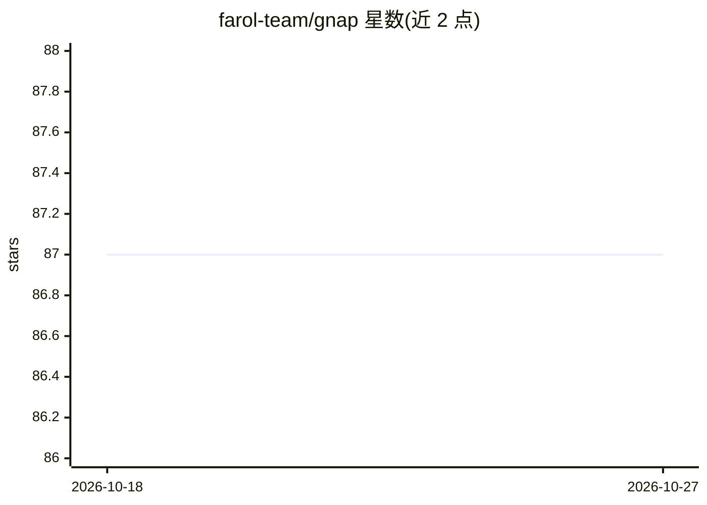

# farol-team/gnap

⭐ 87 · MIT · 推送 2026-03-17 · [GitHub](https://github.com/farol-team/gnap) · 组织维护

**基于 git 仓库的 AI agent 协作协议：四个 JSON 文件协调多 agent 团队**

RFC 草案形式的协议规范：在共享 git 仓库的 .gnap/ 目录下用四类 JSON 文件（agents、tasks、runs、messages）定义 AI agent 与人类的团队协作。每个 agent 运行心跳循环——pull、读取任务与消息、执行工作、commit 并 push；git history 充当审计日志。协议版本为 4，定义任务状态机（backlog→ready→in_progress→review→done）、重试历史与成本追踪字段。无服务器与数据库，任何能 git push 的 agent（OpenClaw、Codex、Claude Code 或自定义）均可参与。仓库本身为协议文档，未提供本产品的安装命令；Farol Labs 团队（4 agent、50+ 任务）在内部使用。

## 筛选速览

| 维度 | 判定 | 备注 |
|---|---|---|
| AI 角色 | `ai-ecosystem` | LLM/agent 周边工具 |
| 许可风险 | `permissive` | MIT |
| 部署形态 | `library` | 以包/库形式分发 |
| 模型依赖 | — | README 未给出锁定关系 |
| 硬件要求 | — | 无带数字的原话,不猜 |
| 安装摩擦 | `low` | 无编译、无系统依赖或容器化 |
| 成熟度 | — | 结构信号不足 |

## 能力要点

- 四个 JSON 实体（Agent/Task/Run/Message）构成全部协议
- 心跳循环 + git 传输，无服务器无数据库，支持离线后同步
- Run 记录提供成本追踪、重试历史与 agent 性能对比数据
- 人与 AI agent 均为一等参与者，reports_to 构建组织树

## 适用场景

- 让多个 AI agent 与人类通过共享 git 仓库分工协作
- 在无服务器基础设施的条件下运行 agent 团队的任务管理
- 基于 git log 审计 agent 的工作、成本与重试历史

## 场景标签

`多智能体` `Agent 框架` · 领域:Agent 开发

## 证据(README 行号)

> L5: # GNAP — coordinate AI agents with just git
> L30: ## How It Works
> L312: GNAP is a protocol — it defines entities and transport, not business logic.

## 星数曲线

2026-10-18 87 → 2026-10-27 87（+0）

---
*卡片 v1 · prompt 1.4 · 生成 2026-10-23 · 置信度 mid · 依据 README sha `837305f62c15` · [字段定义](../../DATASET.md)*
