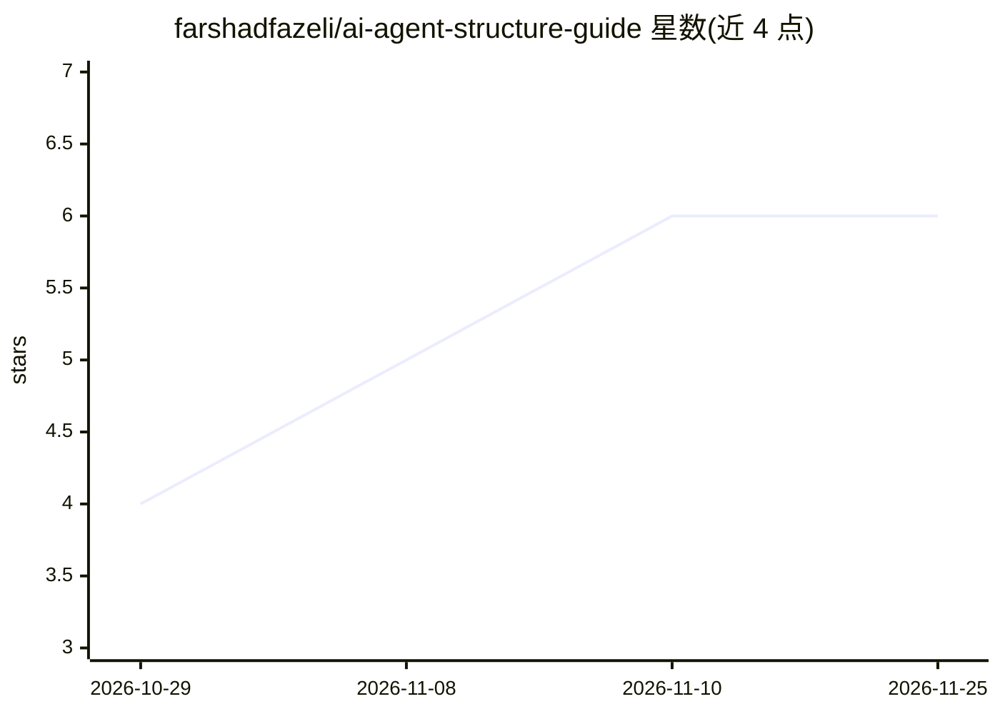

# farshadfazeli/ai-agent-structure-guide

⭐ 6 · HTML · 推送 2026-10-31 · [GitHub](https://github.com/farshadfazeli/ai-agent-structure-guide) · [官网](https://farshadfazeli.github.io/ai-agent-structure-guide/) · 个人维护

**FA/EN 双语 AI Agent 项目结构交互式学习指南**

纯静态网页组成的学习资料：单个 index.html 作为入口卡片，通过 iframe 内嵌三个页面，分别讲解 Agent 项目中各 Markdown 文件（agent.md、rules.md、skill.md 等）的职责、Workflow 与 Skill 的区别对比，以及一份 20 题即时反馈测验。内容为作者对某 AI Agent 课程的个人重述，非官方课程材料。无框架、无构建步骤、无依赖，浏览器直接打开即可运行。

## 筛选速览

| 维度 | 判定 | 备注 |
|---|---|---|
| AI 角色 | `ai-knowledge` | 知识聚合/清单类 |
| 许可风险 | `none` | — |
| 部署形态 | `None` |  |
| 模型依赖 | — | README 未给出锁定关系 |
| 硬件要求 | — | 无带数字的原话,不猜 |
| 安装摩擦 | `low` | 无编译、无系统依赖或容器化 |
| 成熟度 | — | 结构信号不足 |

## 能力要点

- 覆盖 agent.md/rules.md/command.md/security.md 等 7 个文件的职责说明
- Workflow vs Skill 对比页含类比、分步示例与对比表
- 20 题测验提供即时反馈、总分与错题解析
- 波斯语 RTL 与英语 LTR 双语界面可切换

## 适用场景

- 学习 AI Agent 项目中各 Markdown 文件的组织方式
- 教学前快速复习 Agent 架构概念
- 通过测验自检对 Workflow/Skill 区分的理解

## 场景标签

`教程课程` · 领域:学习与行业

## 证据(README 行号)

> L3: An interactive, bilingual (Persian / English) learning hub for understanding how an AI Agent project is structured. 
> L26: |`Agent Quiz.html`|A 20-question quiz about the role of `agent.md`, `rules.md`, `command.md`, `security.md`, `conve
> L39: - Students learning about AI Agent architecture and how the `.md` files fit together.

## 星数曲线

2026-10-29 4 → 2026-11-25 6（+2）

---
*卡片 v1 · prompt 1.4 · 生成 2026-11-20 · 置信度 high · 依据 README sha `3bb142f02ec4` · [字段定义](../../DATASET.md)*
