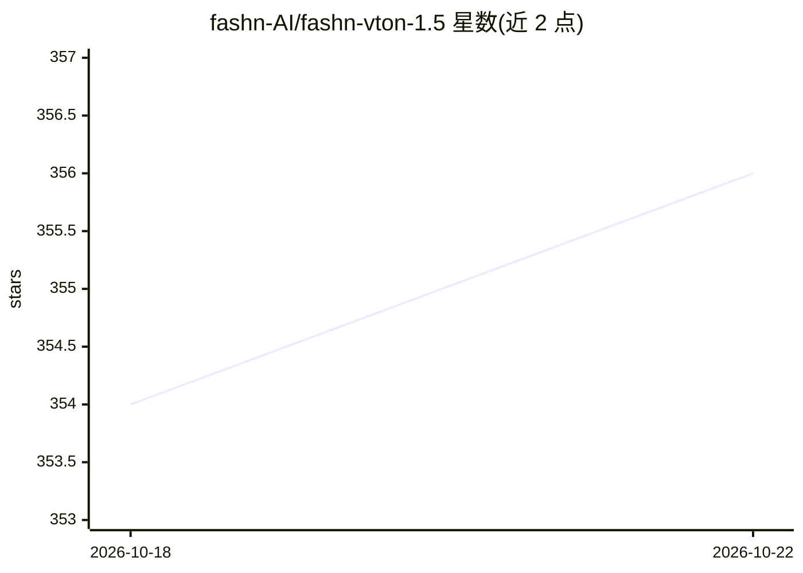

# fashn-AI/fashn-vton-1.5

⭐ 357 · Python · NOASSERTION · 推送 2026-02-01 · [GitHub](https://github.com/fashn-AI/fashn-vton-1.5) · [官网](https://fashn.ai/research/vton-1-5) · 组织维护

**像素空间免分割蒙版的虚拟试穿图像生成模型**

FASHN AI 发布的虚拟试穿模型 v1.5 推理代码仓库：输入人物图像与服装图像，在像素空间直接生成人物穿着该服装的照片级图像，无需分割蒙版；服装图支持模特照与平铺产品图。本地安装通过 git clone 源码加 pip install -e 完成，需另行下载约 2GB 权重（含 DWPose 姿态检测 ONNX 模型），依赖 onnxruntime-gpu 与 CUDA；无 GPU 时可换 CPU 版并转 float32 运行。提供 Python API 与 CLI 示例，覆盖上装/下装/连体装三类。

## 筛选速览

| 维度 | 判定 | 备注 |
|---|---|---|
| AI 角色 | `ai-native` | 本体是模型或模型工具 |
| 许可风险 | `none` | NOASSERTION |
| 部署形态 | `library` | 以包/库形式分发 |
| 模型依赖 | — | README 未给出锁定关系 |
| 硬件要求 | — | 无带数字的原话,不猜 |
| 安装摩擦 | `medium` | 含编译或系统依赖之一 |
| 成熟度 | — | 结构信号不足 |

## 能力要点

- 免分割蒙版，像素空间直接生成试穿图像
- 服装输入支持模特照与平铺产品图
- 附带 DWPose 姿态检测，bf16 精度在 Ampere+ GPU 上运行
- 提供 Python pipeline 与 CLI 示例

## 适用场景

- 电商场景中把服装穿到人物图上生成展示图
- 本地批量生成虚拟试穿效果图像
- 研究像素空间试穿扩散模型的推理效果

## 场景标签

`图像生成` · 领域:内容生成

## 证据(README 行号)

> L11: Virtual try-on model that generates photorealistic images directly in pixel space without requiring segmentation ma
> L15: This repo contains minimal inference code to run virtual try-on with the FASHN VTON v1.5 model weights. Given a per

## 星数曲线

2026-10-18 354 → 2026-10-22 356（+2）

---
*卡片 v1 · prompt 1.4 · 生成 2026-10-21 · 置信度 mid · 依据 README sha `7419d38ae62f` · [字段定义](../../DATASET.md)*
