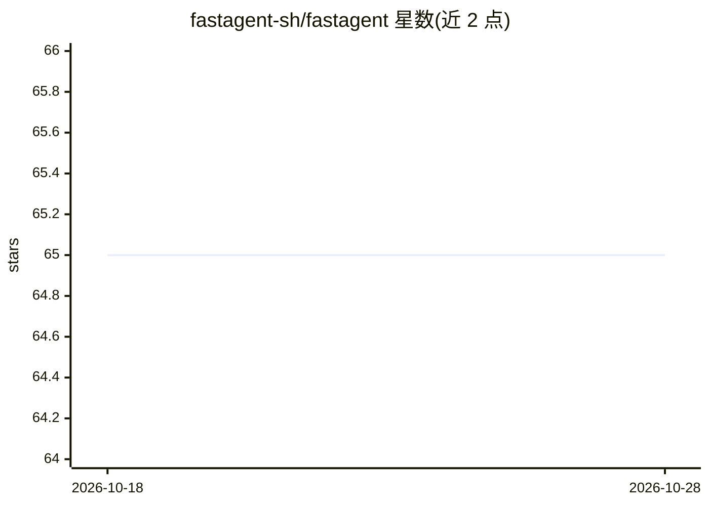

# fastagent-sh/fastagent

⭐ 65 · TypeScript · MIT · 推送 2026-10-27 · [GitHub](https://github.com/fastagent-sh/fastagent) · [官网](https://fastagent.sh) · 组织维护 · 中文 README

**把本地 agent 目录变成线上服务的 TypeScript 运行时**

面向开发者的 agent 服务化运行时：以既有的目录定义（AGENTS.md、Agent Skills、TypeScript 工具）为部署单元，不引入新 DSL，通过 invoke 契约将同一 agent 接入 Telegram、Slack、飞书/Lark、HTTP/SSE 或自定义渠道，也可嵌入 Next/Astro/Hono/Bun/Node 应用。模型接入任意 provider（OpenAI、Anthropic、Google 等），内置 pi harness 且 harness 可替换。部署支持 Docker、Fly、Railway、AWS Bedrock AgentCore。当前 pre-1.0，包 API 在 1.0 前可能收紧。

## 筛选速览

| 维度 | 判定 | 备注 |
|---|---|---|
| AI 角色 | `ai-ecosystem` | LLM/agent 周边工具 |
| 许可风险 | `permissive` | MIT |
| 部署形态 | `library` | 以包/库形式分发 |
| 模型依赖 | — | README 未给出锁定关系 |
| 硬件要求 | — | 无带数字的原话,不猜 |
| 安装摩擦 | `low` | 无编译、无系统依赖或容器化 |
| 成熟度 | `idea` | |

## 能力要点

- 目录即部署单元，无应用构建步骤，无新 DSL
- 同一 agent 服务于 Telegram/Slack/飞书/Lark/HTTP/SSE 多渠道
- fastagent deploy docker|fly|railway|agentcore 生成容器与目标配置及 runbook
- 分层子路径导出（core/node/pi），harness 中立与 runtime 中立在 CI 中断言

## 适用场景

- 把本地终端里的 agent 接入 Telegram/Slack/飞书机器人对外提供服务
- 在自家 Next/Astro 应用中以一个路由嵌入 agent，保留自己的鉴权与数据库
- 把 agent 目录打包部署到 Fly、Railway 或任意 Docker 宿主

## 场景标签

`Agent 框架` · 领域:Agent 开发

## 证据(README 行号)

> L15: A file-defined agent directory can become a live service. FastAgent takes it out of the terminal and serves it in y
> L22: FastAgent is not a new agent-authoring DSL. You bring the existing definition and project layout; FastAgent provide
> L58: - **No model or cloud lock-in.** The Agent Handler contract is harness-neutral, with pi as the built-in harness; br

## 星数曲线

2026-10-18 65 → 2026-10-28 65（+0）

---
*卡片 v1 · prompt 1.4 · 生成 2026-10-24 · 置信度 high · 依据 README sha `b39325c4ad21` · [字段定义](../../DATASET.md)*
