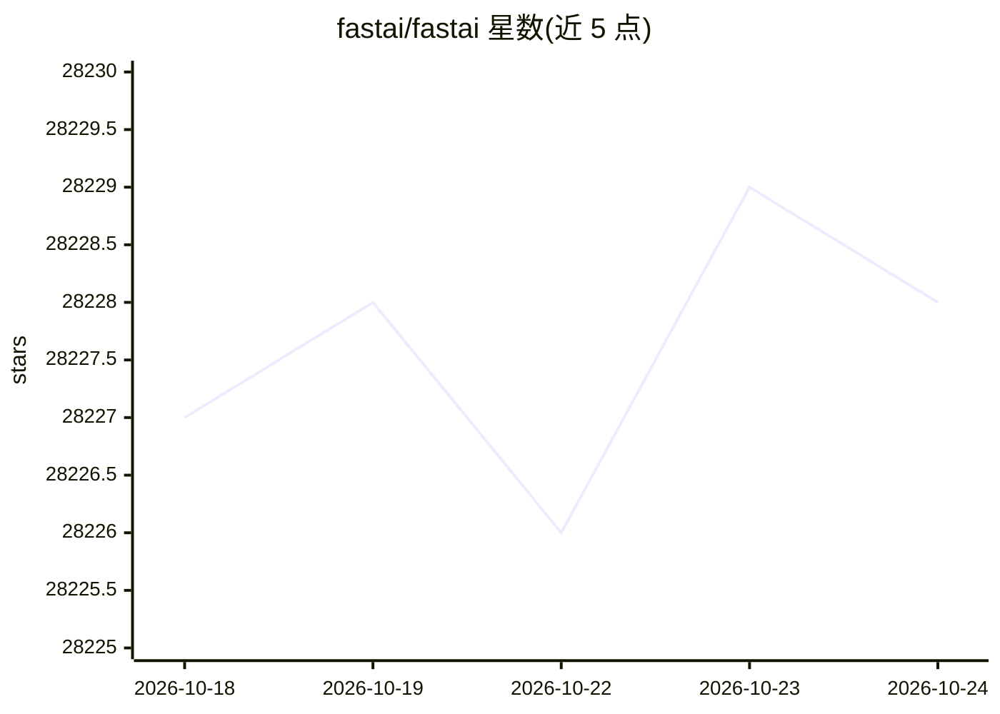

# fastai/fastai

⭐ 28,231 · Jupyter Notebook · Apache-2.0 · 推送 2026-09-21 · [GitHub](https://github.com/fastai/fastai) · [官网](http://docs.fast.ai) · 组织维护

**基于 PyTorch 的深度学习库：分层 API 兼顾易用与可扩展**

fastai 是构建在 PyTorch 之上的深度学习库，面向从业者提供高层组件以快速在标准深度学习领域训练模型，同时为研究者提供可组合的低层组件以构建新方法。关键机制包括 Python 类型分发系统、GPU 优化的计算机视觉库、可重构的优化器抽象、双向回调系统与 data block API。依赖 PyTorch，提供 pip/conda 安装、Colab 免安装使用与官方 Docker 容器；Windows 上 Jupyter 下 num_workers 被重置为 0，视觉任务速度受限。

## 筛选速览

| 维度 | 判定 | 备注 |
|---|---|---|
| AI 角色 | `ai-ecosystem` | LLM/agent 周边工具 |
| 许可风险 | `permissive` | Apache-2.0 |
| 部署形态 | `library` | 以包/库形式分发 |
| 模型依赖 | — | README 未给出锁定关系 |
| 硬件要求 | — | 无带数字的原话,不猜 |
| 安装摩擦 | `low` | 无编译、无系统依赖或容器化 |
| 成熟度 | — | 结构信号不足 |

## 动量与使用信号

- 维护:`active` — 距上次 push 26.9 天,年发版 8,240 位贡献者
- 涨星:近 1 天 **-1**(自 20261016 起算)
- 安装:pypi 包 `fastai` 月下载 301,753
- 平台:WINDOWS / LINUX · 协议:—

## 能力要点

- 分层 API：高层快速建模与低层可组合构件
- Python 类型分发系统与张量语义类型层级
- GPU 优化的计算机视觉库，可用纯 Python 扩展
- 双向回调系统与 data block API

## 适用场景

- 用约 5 行代码训练图像分类、分割、文本情感、推荐、表格模型
- 在自有数据集上训练自己的模型
- 从 PyTorch/Ignite/Lightning 等库迁移并减少训练代码量

## 场景标签

`微调` `模型训练` · 领域:训练与推理

## 证据(README 行号)

> L57: fastai is a deep learning library which provides practitioners with
> L63: possible thanks to a carefully layered architecture, which expresses
> L67: underlying Python language and the flexibility of the PyTorch library.

## 星数曲线

2026-10-18 28,227 → 2026-10-24 28,228（+1）

---
*卡片 v1 · prompt 1.4 · 生成 2026-10-18 · 置信度 high · 依据 README sha `9db4607be0ff` · [字段定义](../../DATASET.md)*
