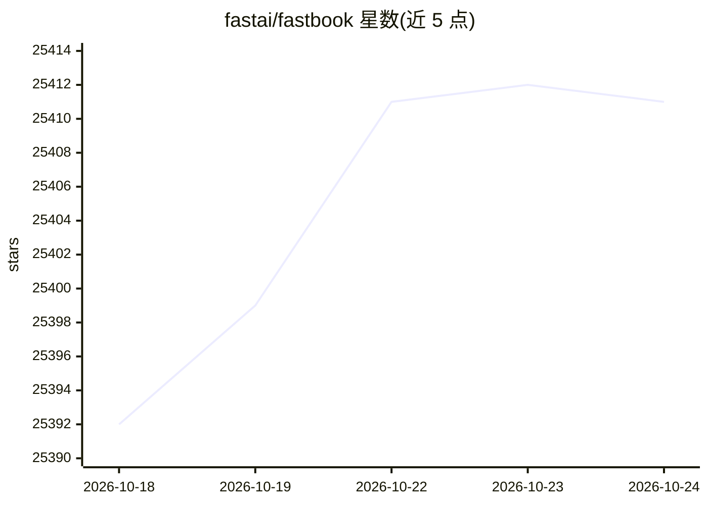

# fastai/fastbook

⭐ 25,414 · Jupyter Notebook · NOASSERTION · 推送 2026-10-12 · [GitHub](https://github.com/fastai/fastbook) · 个人维护 · 中文 README

**以 Jupyter Notebook 形式发布的 fastai 深度学习教材**

《Deep Learning for Coders with fastai and PyTorch》一书的 Notebook 版仓库，内容覆盖深度学习入门、fastai 分层 API 与 PyTorch，包含从 MNIST 基础到 NLP、卷积、优化器与回调等 20 章内容。代码部分采用 GPL v3 许可，散文部分（markdown 单元格）不允许再分发或商业使用，仅可自用复制或 fork。面向学习深度学习的读者，推荐通过 Google Colab 在浏览器中直接运行，无需本地搭建 Python 环境。

## 筛选速览

| 维度 | 判定 | 备注 |
|---|---|---|
| AI 角色 | `ai-knowledge` | 知识聚合/清单类 |
| 许可风险 | `dual` | NOASSERTION |
| 部署形态 | `None` |  |
| 模型依赖 | — | README 未给出锁定关系 |
| 硬件要求 | — | 无带数字的原话,不猜 |
| 安装摩擦 | `low` | 无编译、无系统依赖或容器化 |
| 成熟度 | — | 结构信号不足 |

## 动量与使用信号

- 维护:`active` — 距上次 push 5.5 天,年发版 0,123 位贡献者
- 涨星:近 1 天 **+2**(自 20261016 起算)
- 安装:github 包 `release-assets` 月下载无数据

## 能力要点

- 以 Jupyter Notebook 形式提供全部章节内容
- 覆盖深度学习、fastai 与 PyTorch 入门，含 20 章
- 支持通过 Google Colab 在浏览器中打开运行
- 代码部分采用 GPL v3 许可，配套 MOOC 课程

## 适用场景

- 零环境配置地在 Colab 里学习深度学习课程
- 本地克隆仓库结合 fastai 框架实践书中示例
- 作为 MOOC 教材按章节系统学习 fastai 与 PyTorch

## 场景标签

`教程课程` · 领域:学习与行业

## 证据(README 行号)

> L3: # The fastai book
> L5: These notebooks cover an introduction to deep learning, fastai, and PyTorch. fastai is a layered API for deep learni

## 星数曲线

2026-10-18 25,392 → 2026-10-24 25,411（+19）

---
*卡片 v1 · prompt 1.4 · 生成 2026-10-18 · 置信度 high · 依据 README sha `d6fc6f413202` · [字段定义](../../DATASET.md)*
