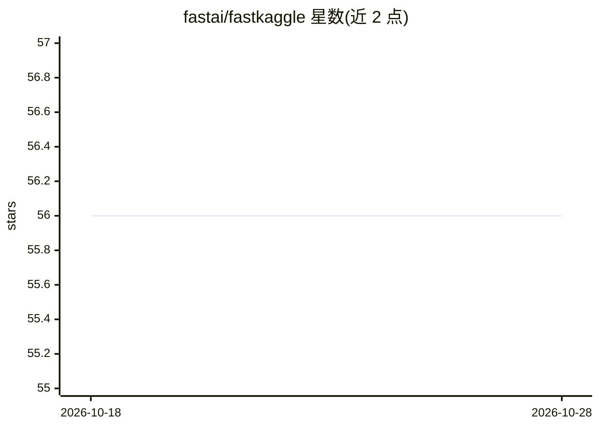

# fastai/fastkaggle

⭐ 56 · Jupyter Notebook · Apache-2.0 · 推送 2026-09-21 · [GitHub](https://github.com/fastai/fastkaggle) · [官网](https://fastai.github.io/fastkaggle/) · 组织维护

**给竞赛/数据科学者的 Kaggle 工作流 Python 工具库**

fastai 维护的 Python 库，封装 Kaggle 竞赛与数据集常用操作：检测是否运行在 Kaggle 环境（iskaggle）、setup_comp 下载竞赛数据并补装缺失模块、competition_submit 提交预测文件、push_notebook 推送笔记本，以及将 pip 库或 requirements.txt 打包上传为 Kaggle 数据集（供无网络推理竞赛离线安装依赖）。需 Python 3.10+、kaggle API v2+ 与 Kaggle 凭据。

## 筛选速览

| 维度 | 判定 | 备注 |
|---|---|---|
| AI 角色 | `ai-ecosystem` | LLM/agent 周边工具 |
| 许可风险 | `permissive` | Apache-2.0 |
| 部署形态 | `library` | 以包/库形式分发 |
| 模型依赖 | — | README 未给出锁定关系 |
| 硬件要求 | — | 无带数字的原话,不猜 |
| 安装摩擦 | `low` | 无编译、无系统依赖或容器化 |
| 成熟度 | — | 结构信号不足 |

## 能力要点

- setup_comp 下载竞赛数据并自动补装缺失/过时模块
- 提交预测文件、推送笔记本到 Kaggle Notebooks
- 将 pip 库列表或 requirements.txt 打包为 Kaggle 数据集并版本更新
- 支持无网络推理竞赛的离线依赖安装方案

## 适用场景

- 本地开发、Kaggle 上跑竞赛的一键数据准备与提交
- 为无网络推理竞赛准备离线可安装的库数据集
- 批量将多个 pip 库发布为 Kaggle 数据集并保持版本更新

## 场景标签

 · 领域:数据科学/机器学习工作流

## 证据(README 行号)

> L23: It provides a `setup_comp` function which gets a path to the data for a competition, downloading it if needed, and 
> L31: There’s also `competition_submit` to submit a predictions file, `push_notebook` to push a notebook to Kaggle Notebo

## 星数曲线

2026-10-18 56 → 2026-10-28 56（+0）

---
*卡片 v1 · prompt 1.4 · 生成 2026-10-24 · 置信度 mid · 依据 README sha `6a9aa5f9b9c9` · [字段定义](../../DATASET.md)*
