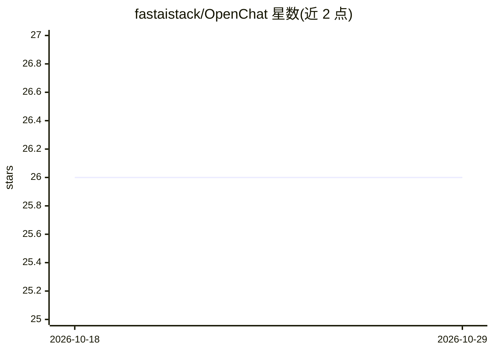

# fastaistack/OpenChat

⭐ 26 · Python · MIT · 推送 2025-11-18 · [GitHub](https://github.com/fastaistack/OpenChat) · [官网](https://fastaistack.github.io/OpenChat/) · 组织维护 · 中文 README

**跨平台桌面多模型 AI 聊天客户端，含联网搜索、知识库与文档问答**

面向终端用户的 Windows/macOS 桌面 AI 聊天应用，以 MIT 许可开源、提供官方安装包，聊天记录与文件本地存储。功能包括接入 OpenAI、DeepSeek、Kimi、智谱等云端模型，兼容 OpenRouter，支持经 Ollama 本地部署模型；内置 Web 检索（默认 SearxNG 后端）、知识库问答、PDF/Office 文档对话、自定义 Agent、沉浸式翻译（五语种）、敏感词过滤，Beta 版本新增 DeepSeek-OCR 图片识别。要求 8GB 以上内存，macOS 首次启动需处理安全机制。

## 筛选速览

| 维度 | 判定 | 备注 |
|---|---|---|
| AI 角色 | `ai-native` | 本体是模型或模型工具 |
| 许可风险 | `permissive` | MIT |
| 部署形态 | `desktop` | 安装包/桌面程序 |
| 模型依赖 | local-ok | 支持本地模型 |
| 硬件要求 | — | 无带数字的原话,不猜 |
| 安装摩擦 | `low` | 无编译、无系统依赖或容器化 |
| 成熟度 | `idea` | |

## 能力要点

- 多模型接入：云端平台（OpenAI/DeepSeek/OpenRouter 等）与 Ollama 本地部署
- 知识库问答与文本/PDF/Office 文档对话
- 自定义与预置 Agent 系统、沉浸式文档翻译（中英日韩法）
- DeepSeek-OCR Beta：图片 OCR、Markdown 转换、图表解析与图像描述

## 适用场景

- 在一个桌面客户端里同时使用多家云端与本地模型聊天
- 基于个人文档与知识库做问答和 PDF 翻译
- 配置专属 Agent 并做敏感词过滤以控制内容合规
- 离线/本地场景下经 Ollama 运行模型

## 场景标签

`聊天机器人` `文档问答` `OCR` · 领域:对话与助手

## 证据(README 行号)

> L5:  Open Source LLMs Chat Application
> L51: - 🌐 **Compatible with Leading Cloud-based AI Models**: Supports OpenAI, Deepseek, Silicon Flow, etc.
> L58: - 📚 **Knowledge-based Q&A**: Intelligently processes various inquiries and provides reliable answers.

## 星数曲线

2026-10-18 26 → 2026-10-29 26（+0）

---
*卡片 v1 · prompt 1.4 · 生成 2026-10-26 · 置信度 mid · 依据 README sha `fe6dfb41d185` · [字段定义](../../DATASET.md)*
