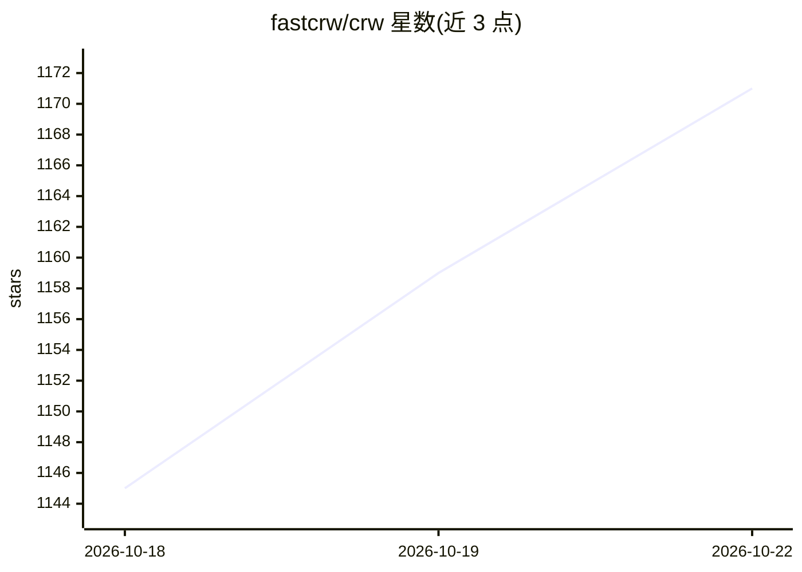

# fastcrw/crw

⭐ 1,173 · Rust · AGPL-3.0 · 推送 2026-10-21 · [GitHub](https://github.com/fastcrw/crw) · [官网](https://fastcrw.com) · 组织维护

**Rust 单二进制网页抓取/爬取/搜索 API，供 AI agent 经 MCP 调用**

用 Rust 实现的网页抓取引擎，提供 scrape/crawl/map/search/extract 五类操作，把 URL 转为 markdown 或结构化 JSON，并以 Firecrawl 兼容 REST API 与 MCP server 形式交付，供 Claude Code、Cursor 等 AI 编程工具调用。以单二进制本地运行（README 称空闲约 14 MB 内存），也可切换到托管云 API（1000 免费额度）。提供 curl 一键安装、CLI、Python/Node SDK 与 npm 安装的 MCP server，自述在 1000-URL 基准与 AA-Omniscience 问答基准上的成绩可复现。本地与云端能力可能有差异。

## 筛选速览

| 维度 | 判定 | 备注 |
|---|---|---|
| AI 角色 | `ai-ecosystem` | LLM/agent 周边工具 |
| 许可风险 | `viral` | AGPL-3.0 |
| 部署形态 | `library` | 以包/库形式分发 |
| 模型依赖 | — | README 未给出锁定关系 |
| 硬件要求 | — | 无带数字的原话,不猜 |
| 安装摩擦 | `low` | 无编译、无系统依赖或容器化 |
| 成熟度 | — | 结构信号不足 |

## 能力要点

- scrape/crawl/map/search/extract 五类操作，URL 转 markdown 或结构化 JSON
- 单二进制本地运行，另有托管 API 与 1000 免费额度
- MCP server（npx crw-mcp install）自动注册到已检测到的 AI 编程工具
- Firecrawl 兼容 API，附 Firecrawl 迁移指南与可复现基准

## 适用场景

- 为 AI agent 或编程助手提供联网搜索与网页转 markdown 的 MCP 工具
- 本地自托管网页爬取，替代 Firecrawl/Tavily 类服务
- 用 Python/Node SDK 在应用中集成抓取与结构化抽取

## 场景标签

`网页抓取` · 领域:效率与自动化

## 证据(README 行号)

> L5:  Turn URLs into clean markdown or structured
> L131: ### MCP for AI agents
> L41: Claude Code, Cursor, Codex, Gemini CLI, OpenCode and Windsurf are picked up

## 星数曲线

2026-10-18 1,145 → 2026-10-22 1,171（+26）

---
*卡片 v1 · prompt 1.4 · 生成 2026-10-21 · 置信度 high · 依据 README sha `9ab0da76427f` · [字段定义](../../DATASET.md)*
