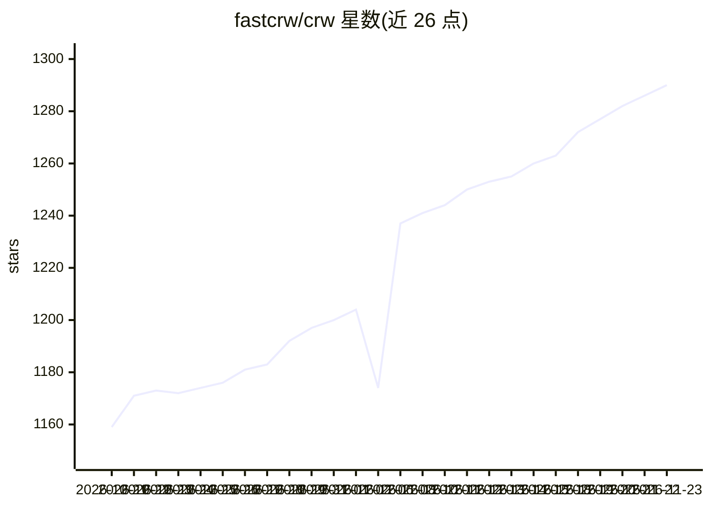

# fastcrw/crw

⭐ 1,290 · Rust · AGPL-3.0 · 推送 2026-11-21 · [GitHub](https://github.com/fastcrw/crw) · [官网](https://fastcrw.com) · 个人维护

**Rust 编写的网页抓取/爬取/搜索 API，供 AI agent 接入**

以单一 Rust 二进制提供的网页数据工具，覆盖 scrape、crawl、map、search、extract 五类操作，输出 markdown、HTML、截图或 schema JSON；提供 Firecrawl 兼容的 REST API、Python/Node SDK 与 CLI。通过 MCP server 及自动注册机制接入 Claude Code、Cursor 等 AI 编码工具。部署方式为本地自托管或托管云（Managed API，含代理与 JS 渲染），README 给出基准对比数据与迁移指南。

## 筛选速览

| 维度 | 判定 | 备注 |
|---|---|---|
| AI 角色 | `ai-ecosystem` | LLM/agent 周边工具 |
| 许可风险 | `viral` | AGPL-3.0 |
| 部署形态 | `library` | 以包/库形式分发 |
| 模型依赖 | — | README 未给出锁定关系 |
| 硬件要求 | — | 无带数字的原话,不猜 |
| 安装摩擦 | `low` | 无编译、无系统依赖或容器化 |
| 成熟度 | — | 结构信号不足 |

## 能力要点

- Firecrawl 兼容 API（/scrape、/crawl、/search），附迁移指南
- MCP server 通过 npx crw-mcp 安装并自动注册到已检测到的 AI 工具
- scrape/crawl/map/search/extract 五种操作，支持 markdown/HTML/截图/结构化 JSON 输出
- 本地自托管与托管云两种运行模式，含 Python/Node SDK 与 CLI

## 适用场景

- 为 AI agent 提供网页搜索与抓取的 MCP 工具
- 将网页批量转换为 markdown 供 LLM 处理
- 自托管环境下做站点爬取与结构化字段抽取
- 从 Firecrawl 迁移到兼容 API 的自建部署

## 场景标签

`网页抓取` `文档解析` · 领域:效率与自动化

## 证据(README 行号)

> L131: ### MCP for AI agents
> L137: Installs the CRW skill and MCP server in your detected AI tools. `crw setup` can

## 星数曲线

2026-10-21 1,159 → 2026-11-23 1,290（+131）

---
*卡片 v1 · prompt 1.4 · 生成 2026-11-23 · 置信度 mid · 依据 README sha `c262b182ff09` · [字段定义](../../DATASET.md)*
