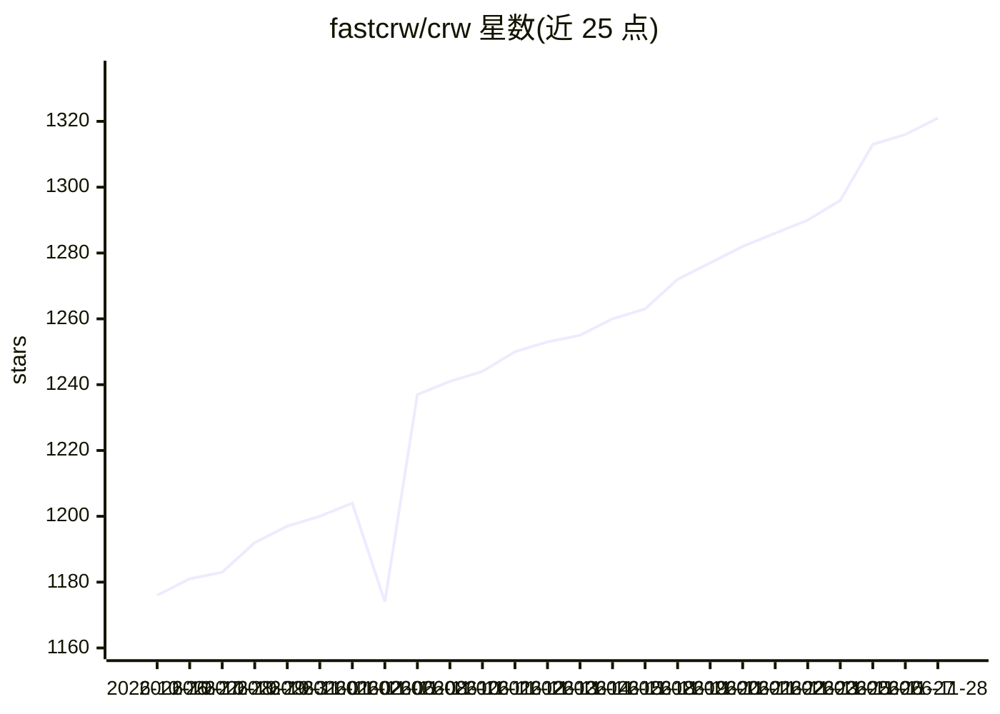

# fastcrw/crw

⭐ 1,321 · Rust · AGPL-3.0 · 推送 2026-11-27 · [GitHub](https://github.com/fastcrw/crw) · [官网](https://fastcrw.com) · 个人维护

**面向 AI agent 的网页抓取/爬取/搜索 API，兼容 Firecrawl**

以 Rust 编写的网页抓取工具，提供 scrape、crawl、map、search、extract 五种操作，输出 markdown/HTML/结构化 JSON。提供 Firecrawl 兼容 API、CLI、Python/Node SDK 与 MCP server，可自动注册到已安装的 AI 编码工具。支持本地单二进制运行或使用托管云 API（托管版含代理、JS 渲染与计费 credits）。README 附基准测试章节，含与其他爬取产品的对比数据。

## 筛选速览

| 维度 | 判定 | 备注 |
|---|---|---|
| AI 角色 | `ai-enhanced` | 去掉 AI 部分产品仍成立 |
| 许可风险 | `viral` | AGPL-3.0 |
| 部署形态 | `library` | 以包/库形式分发 |
| 模型依赖 | — | README 未给出锁定关系 |
| 硬件要求 | — | 无带数字的原话,不猜 |
| 安装摩擦 | `low` | 无编译、无系统依赖或容器化 |
| 成熟度 | — | 结构信号不足 |

## 能力要点

- 单一引擎支持 scrape/crawl/map/search/extract 五种操作
- 提供 Firecrawl 兼容 API 与 Firecrawl 迁移文档
- 提供 MCP server，可自动注册到 Claude Code、Cursor 等 AI 工具
- 本地单二进制运行，同时提供托管云 API 与 Python/Node SDK

## 适用场景

- 给 AI agent 或编码工具接入网页抓取与搜索能力
- 将网页 URL 批量转为 markdown 或结构化 JSON
- 自托管场景下替代现有爬取 API 做站点抓取

## 场景标签

`网页抓取` · 领域:效率与自动化

## 证据(README 行号)

> L8:  Run it locally as a small Rust binary or use the managed API.
> L131: ### MCP for AI agents
> L143: ||Managed API|Local / self-hosted|

## 星数曲线

2026-10-26 1,176 → 2026-11-28 1,321（+145）

---
*卡片 v1 · prompt 1.4 · 生成 2026-11-24 · 置信度 high · 依据 README sha `0f4a5615645a` · [字段定义](../../DATASET.md)*
