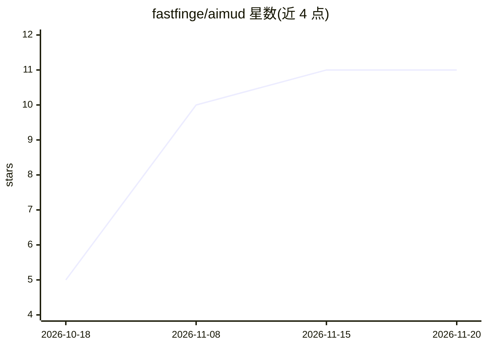

# fastfinge/aimud

⭐ 11 · Python · BSD-3-Clause · 推送 2026-10-22 · [GitHub](https://github.com/fastfinge/aimud) · 个人维护

**文本 MUD 游戏：世界、人物与动词随游玩由 AI 实时生成**

基于 Evennia 6.1 与 Python 3.13 的文字 MUD，无预设地图或对话树：玩家用一两句话描述世界后，房间、物品、人物与动词规则在首次被触达时由模型生成并持久化以保持一致性。名词以词典义项锚定为 kind，动词规则按 affordances 缓存复用；NPC 带目标规划器与记忆库，仅在有人在场时消耗模型调用。每个生成任务可单独配置模型与采样参数，通过 OpenRouter 接入任意模型。项目自述处于早期开发阶段。

## 筛选速览

| 维度 | 判定 | 备注 |
|---|---|---|
| AI 角色 | `ai-native` | 本体是模型或模型工具 |
| 许可风险 | `permissive` | BSD-3-Clause |
| 部署形态 | `library` | 以包/库形式分发 |
| 模型依赖 | locked-api |  |
| 硬件要求 | — | 无带数字的原话,不猜 |
| 安装摩擦 | `low` | 无编译、无系统依赖或容器化 |
| 成熟度 | `idea` | |

## 能力要点

- 房间、物品、人物与动词规则按需生成并缓存，世界保持一致
- kind/affordance 机制：名词锚定词典义项，动词规则学习一次全类复用
- NPC 具备目标规划、相关度记忆检索与自主行动，无人时休眠零开销
- 每个生成任务（命名/对话/规则判定）可分别设置模型与采样参数

## 适用场景

- 自建并游玩一个由 AI 生成的文字冒险世界
- 观察 NPC 在生成世界中自主追逐目标与互动
- 按任务为对话与规则判定分别调配模型与采样设置

## 场景标签

 · 领域:游戏/交互娱乐

## 证据(README 行号)

> L3: A text MUD where the world is written as you walk through it.
> L13: Built on Evennia 6.1, Python 3.13, and any model

## 星数曲线

2026-10-18 5 → 2026-11-20 11（+6）

---
*卡片 v1 · prompt 1.4 · 生成 2026-11-18 · 置信度 high · 依据 README sha `11f7863427e9` · [字段定义](../../DATASET.md)*
