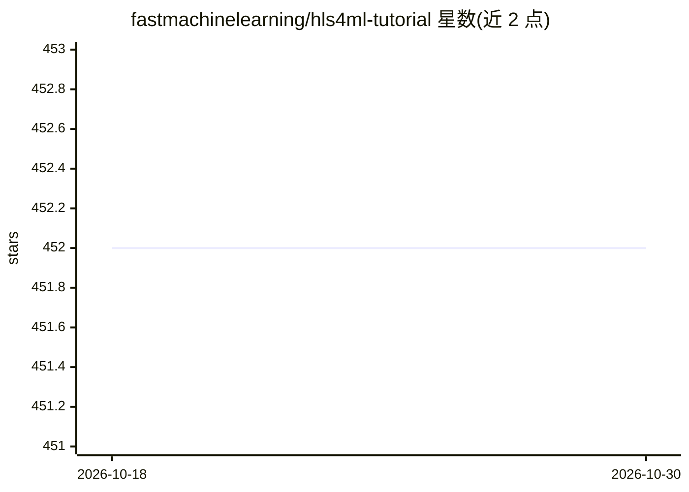

# fastmachinelearning/hls4ml-tutorial

⭐ 452 · Jupyter Notebook · 推送 2026-10-19 · [GitHub](https://github.com/fastmachinelearning/hls4ml-tutorial) · [官网](http://fastmachinelearning.org/hls4ml-tutorial/) · 组织维护

**hls4ml 教程笔记本集合：FPGA 上部署机器学习模型的练习**

hls4ml 项目的教程仓库，以 Jupyter 笔记本形式提供机器学习模型（含剪枝、量化感知训练）转换为 FPGA 高层次综合（HLS）代码的练习，配有介绍性幻灯片和目录化的笔记本组织。运行方式包括在线 Binder 与本地 Conda；本地运行要求已安装 AMD Vitis HLS 并 source 其 settings64.(c)sh 设置环境变量，再按 environment.yml 创建 conda 环境。

## 筛选速览

| 维度 | 判定 | 备注 |
|---|---|---|
| AI 角色 | `ai-knowledge` | 知识聚合/清单类 |
| 许可风险 | `none` | — |
| 部署形态 | `None` |  |
| 模型依赖 | — | README 未给出锁定关系 |
| 硬件要求 | — | 无带数字的原话,不猜 |
| 安装摩擦 | `low` | 无编译、无系统依赖或容器化 |
| 成熟度 | — | 结构信号不足 |

## 能力要点

- Jupyter Book 组织的教程笔记本（自动生成目录）
- 支持 Binder 在线运行与本地 Conda 环境两种方式
- 配套各练习的介绍幻灯片

## 适用场景

- 学习如何把训练好的模型经 HLS 转换部署到 FPGA
- 在 Binder 上免配置体验 hls4ml 教程
- 了解剪枝与量化感知训练在 FPGA 部署中的用法

## 场景标签

`教程课程` · 领域:学习与行业

## 证据(README 行号)

> L1: # hls4ml-tutorial: Tutorial notebooks for `hls4ml`
> L14: Running the tutorials requires AMD Vitis HLS to be installed, see here.

## 星数曲线

2026-10-18 452 → 2026-10-30 452（+0）

---
*卡片 v1 · prompt 1.4 · 生成 2026-10-21 · 置信度 high · 依据 README sha `ffc8b90a8b7e` · [字段定义](../../DATASET.md)*
