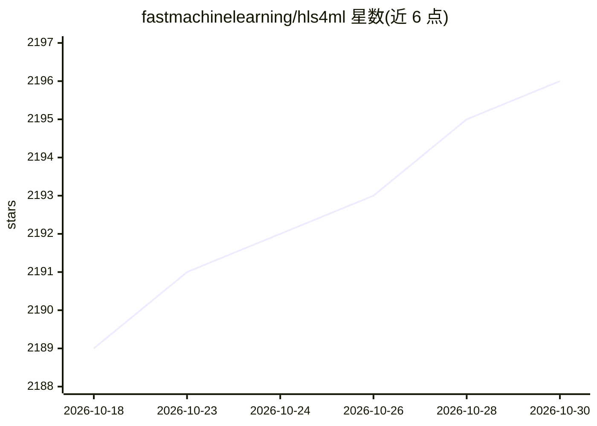

# fastmachinelearning/hls4ml

⭐ 2,196 · Python · Apache-2.0 · 推送 2026-10-29 · [GitHub](https://github.com/fastmachinelearning/hls4ml) · [官网](https://fastmachinelearning.org/hls4ml) · 组织维护

**将 Keras/PyTorch/ONNX 模型转为 FPGA 上运行的 HLS 固件**

面向超低延迟 FPGA 推理的 Python 包：读取传统开源机器学习框架训练的模型，用高层次综合（HLS）生成可配置的固件实现。支持 Xilinx Vivado HLS、Vitis HLS、Intel HLS、Catapult HLS 与 Altera HLS IP Gen 多种后端，可通过 backend 参数切换。根植于高能物理（CERN LHC 触发系统），也被用于量子计算控制、核聚变反馈、卫星低功耗监测与生物医学信号处理等场景。由 FastML 团队维护，获 NSF/DOE/ERC 等资助。

## 筛选速览

| 维度 | 判定 | 备注 |
|---|---|---|
| AI 角色 | `ai-native` | 本体是模型或模型工具 |
| 许可风险 | `permissive` | Apache-2.0 |
| 部署形态 | `library` | 以包/库形式分发 |
| 模型依赖 | — | README 未给出锁定关系 |
| 硬件要求 | — | 无带数字的原话,不猜 |
| 安装摩擦 | `low` | 无编译、无系统依赖或容器化 |
| 成熟度 | — | 结构信号不足 |

## 能力要点

- 将 Keras/PyTorch/ONNX 等开源框架模型转译为 HLS 固件
- 支持 Vivado/Vitis/Intel/Catapult/Altera 等多种 HLS 后端
- 面向超低延迟 FPGA 推理，可读取综合后报告
- 提供 profiling 扩展依赖安装方式

## 适用场景

- 把训练好的神经网络部署到 FPGA 上做实时低延迟推理
- 高能物理触发系统等科学装置的边缘 ML 加速
- 卫星等低功耗场景的模型硬件化部署

## 场景标签

`推理引擎` · 领域:训练与推理

## 证据(README 行号)

> L10: A package for machine learning inference in FPGAs. We create firmware implementations of machine learning algorithm
> L12: hls4ml is designed for ultra-low-latency inference on FPGAs. While it has strong roots in high-energy physics appli
> L45: We will build the project using Xilinx Vivado HLS, which can be downloaded and installed from here. Alongside Vivad

## 星数曲线

2026-10-18 2,189 → 2026-10-30 2,196（+7）

---
*卡片 v1 · prompt 1.4 · 生成 2026-10-21 · 置信度 high · 依据 README sha `2d0171b6c850` · [字段定义](../../DATASET.md)*
