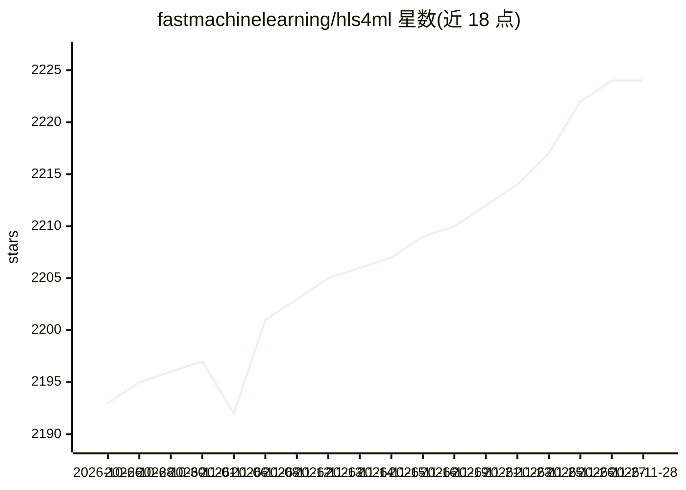

# fastmachinelearning/hls4ml

⭐ 2,224 · Python · Apache-2.0 · 推送 2026-11-27 · [GitHub](https://github.com/fastmachinelearning/hls4ml) · [官网](https://fastmachinelearning.org/hls4ml) · 组织维护

**把机器学习模型转为 FPGA 固件的 HLS 转换库**

Python 包，将 Keras/PyTorch/ONNX 等开源机器学习框架的模型转换为高层综合（HLS）代码，生成可在 FPGA 上运行的固件实现，面向超低延迟推理。构建后端可切换：支持 Xilinx Vivado HLS、Vitis HLS、Intel HLS、Catapult HLS、Altera HLS IP Gen，通过 backend 参数选择。起源于高能物理（CERN L1 触发系统），也用于量子计算控制、核聚变反馈、卫星低功耗监测、生物医学信号处理等场景。通过 PyPI 安装，提供 profiling 扩展依赖、文档、教程与 FAQ。

## 筛选速览

| 维度 | 判定 | 备注 |
|---|---|---|
| AI 角色 | `ai-ecosystem` | LLM/agent 周边工具 |
| 许可风险 | `permissive` | Apache-2.0 |
| 部署形态 | `library` | 以包/库形式分发 |
| 模型依赖 | — | README 未给出锁定关系 |
| 硬件要求 | — | 无带数字的原话,不猜 |
| 安装摩擦 | `low` | 无编译、无系统依赖或容器化 |
| 成熟度 | — | 结构信号不足 |

## 能力要点

- 将开源 ML 框架模型翻译为可综合的 HLS 固件实现
- 支持 Vivado HLS、Vitis HLS、Intel HLS、Catapult HLS、Altera HLS 多种后端
- 面向 FPGA 超低延迟推理设计
- 提供 profiling 扩展依赖与在线教程

## 适用场景

- 把训练好的神经网络部署到 FPGA 做超低延迟推理
- 粒子物理实验中构建 L1 触发系统的推断固件
- 卫星等低功耗场景的板载环境监测模型部署
- 生物医学信号（如心律不齐分类）的实时硬件推断

## 场景标签

 · 领域:机器学习部署/硬件加速

## 证据(README 行号)

> L9: A package for machine learning inference in FPGAs. We create firmware implementations of machine learning algorithms
> L44: We will build the project using Xilinx Vivado HLS, which can be downloaded and installed from here. Alongside Vivad
> L25: pip install hls4ml

## 星数曲线

2026-10-26 2,193 → 2026-11-28 2,224（+31）

---
*卡片 v1 · prompt 1.4 · 生成 2026-11-28 · 置信度 high · 依据 README sha `7492a5c18184` · [字段定义](../../DATASET.md)*
