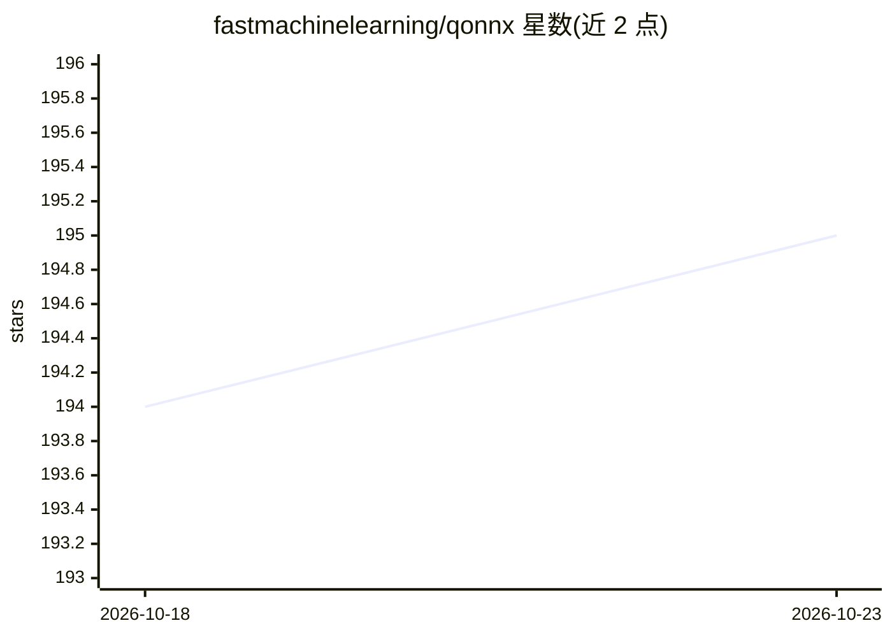

# fastmachinelearning/qonnx

⭐ 195 · Python · Apache-2.0 · 推送 2026-09-01 · [GitHub](https://github.com/fastmachinelearning/qonnx) · [官网](https://qonnx.readthedocs.io/) · 组织维护

**在 ONNX 中表示任意精度量化神经网络的算子与 Python 工具库**

QONNX 定义 IntQuant、FloatQuant、BipolarQuant、Trunc 等自定义算子，将二值/三值/任意位宽整数及可配置指数/尾数位数的 minifloat 量化表示引入 ONNX，量化值以标准 float 承载以保持 protobuf 兼容。仓库提供 Python 工具集：执行 QONNX 模型做功能验证、形状推断与常量折叠等优化、统计混合精度 MAC/参数/激活量的推理成本、编写变换与可执行自定义算子的基础设施，以及 QONNX 与 QCDQ 量化表示转换。Brevitas、QKeras、HAWQ 等训练框架可导出到 QONNX，FINN、hls4ml 可导入部署到 FPGA。

## 筛选速览

| 维度 | 判定 | 备注 |
|---|---|---|
| AI 角色 | `ai-ecosystem` | LLM/agent 周边工具 |
| 许可风险 | `permissive` | Apache-2.0 |
| 部署形态 | `library` | 以包/库形式分发 |
| 模型依赖 | — | README 未给出锁定关系 |
| 硬件要求 | — | 无带数字的原话,不猜 |
| 安装摩擦 | `low` | 无编译、无系统依赖或容器化 |
| 成熟度 | `idea` | |

## 能力要点

- 自定义算子表示任意位宽整数与 minifloat 量化（含 OCP MX 数据类型）
- qonnx-inference-cost 统计混合精度 MAC/参数/激活量推理成本
- qonnx-convert 在 QONNX 与 QCDQ 量化表示间转换
- 配套模型动物园提供预训练 QONNX 模型

## 适用场景

- 将 QAT 训练框架产出的量化模型统一为 ONNX 兼容表示
- 为 FPGA 部署（FINN/hls4ml）准备量化模型
- 评估量化模型的混合精度推理成本

## 场景标签

`模型量化` · 领域:训练与推理

## 证据(README 行号)

> L13: QONNX (Quantized ONNX) introduces several custom operators -- `IntQuant`, `FloatQuant`, `BipolarQuant`, and `Trunc`
> L20: This repository contains a set of Python utilities to work with QONNX models, including but not limited to:

## 星数曲线

2026-10-18 194 → 2026-10-23 195（+1）

---
*卡片 v1 · prompt 1.4 · 生成 2026-10-22 · 置信度 high · 依据 README sha `df4a7a8fdad5` · [字段定义](../../DATASET.md)*
